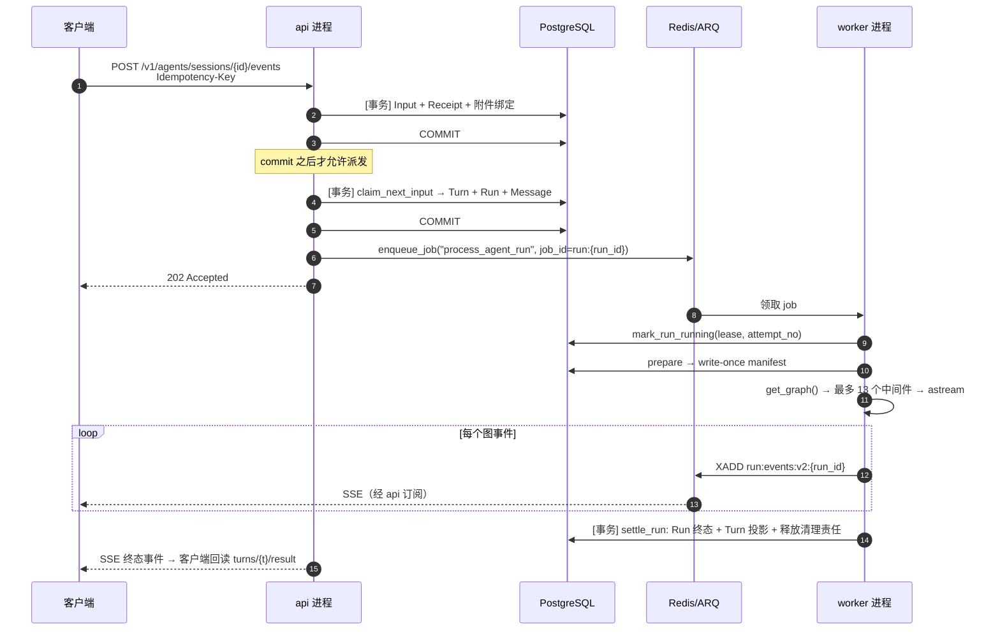
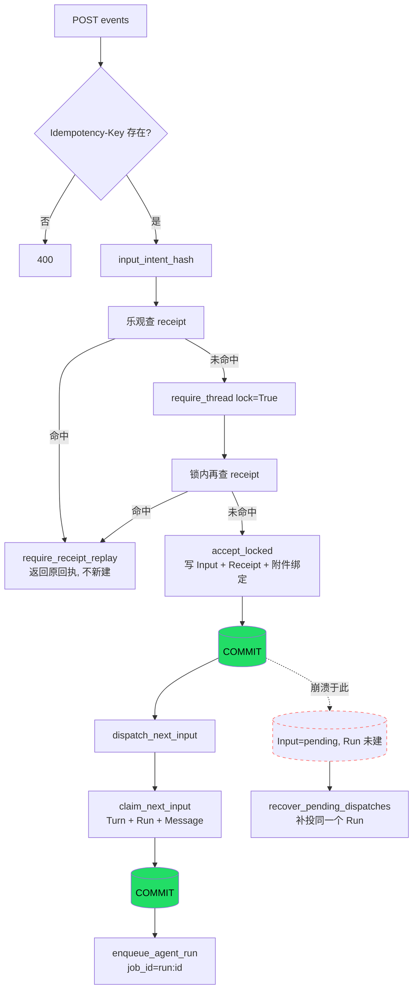
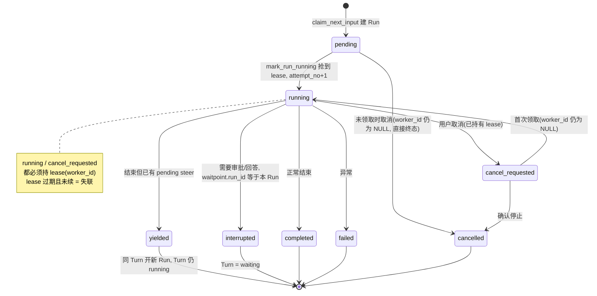

# Yuxi 后端 Onboarding（不含前端）

> 目标读者：要在此仓库上做二次开发、但不想先读完全部代码的人。
> 范围：后端框架与路由、本地部署、Agent 层（harness）、以及**以一次对话为例的代码阅读顺序**。
> 事实来源：`backend/` 源码、`docker-compose.yml`、`docs/`。行号对应 `v0.8.0.beta8`（5c93360），改代码后会漂移，用符号搜索重定位。
>
> 说明：本文件放在 `docs/vibe/`（被 git 忽略的本地目录）。想长期保留就移到 `docs/develop-guides/` 并加 sidebar 条目，那时需要跑 docs build 与相对链接检查。
>
> 图表约定：`mermaid` 块在 VS Code 预览与 GitHub 上直接可渲染，但本仓库的 `docs/.vitepress/config.mts` **没有** mermaid 插件，正式发布时要改 ASCII 或先加插件；`ascii` 块到处都能看。

---

## 0. 先记住六个事实

这六条决定了你 90% 的改动该落在哪。

1. **单仓库、多技术栈**：`backend/`（Python/FastAPI）、`frontend/`（Vue3/Vite）、`packages/yuxi-cli`（npm）。依赖事实分别是 `backend/pyproject.toml`+`backend/uv.lock`、`frontend/package.json`+`pnpm-lock.yaml`、`packages/*/package.json`。**仓库根没有** `pyproject.toml` / `requirements.txt`。
2. **后端只有一个包** `backend/yuxi`。`api/` 和 `workers/` 是进程适配层，`modules/` 按业务域放用例，`infrastructure/` 放技术连接，`bootstrap/` 放启动装配，`migrations/` 独占 Schema 修改。
3. **PostgreSQL 是唯一业务事实 Owner**。Redis/ARQ 只负责投递、短期事件、取消和缓存。任何"最终状态"都要在 PG 里能读到。
4. **HTTP 路由必须薄**。路由只做 HTTP 模型、认证依赖、状态码、响应装配；跨 repository 的用例进 `modules/<域>/services`，持久化查询进同域 `repositories`。
5. **Docker Compose 是开发拓扑的事实来源**。先看容器、日志、配置，再怀疑代码。
6. **Agent 层不是"调一次 LLM"**。它是「持久 Input 队列 → Turn → Run(lease) → LangGraph 图 → 事件流 → 终态收敛」这条完整链路。看懂这条链路，等于看懂了整个后端。

---

## 1. 系统地图

### 1.1 进程

| 进程 | 入口 | 职责 |
|---|---|---|
| `api` | `backend/yuxi/api/main.py` | FastAPI，`/api` 下全部 HTTP + SSE；`/api/mcp` 只读知识库 MCP 共用进程与端口 |
| `worker` | `backend/yuxi/workers/main.py` → `workers/settings.py` | ARQ worker，执行 AgentRun、后台作业、定时任务 |
| `app-init` | `backend/yuxi/bootstrap/app.py` | 一次性部署任务：建/校验 Schema，同步内置 options、供应商、Agent 预设、MCP、内置 Skill |
| `storage-init` | `docker/storage-init.sh`（镜像 `docker/storage-init.Dockerfile`） | 一次性：修正挂载目录属主与模式，不递归改已有文件 |
| `sandbox-runner` | `backend/yuxi/sandbox_runner` | 唯一持 Docker socket 的进程，按 Run 懒建临时容器（`--profile container`） |
| `frontend` | `frontend/` | Vite dev server，只挂 `src`/`test`/`public`/`index.html`/`vite.config.js` |
| 依赖服务 | compose | `postgres`、`redis`、`minio`、`milvus`+`etcd`、`graph`(Neo4j)、可选 `mineru-api`（`--profile all`） |

启动顺序由 compose `depends_on` 强制。这意味着 **Schema 和内置内容永远不是 API 建的**。

```ascii
  postgres ┐
  redis    ├─ healthy ──┐
  minio    ┘            │
                        ▼
                 storage-init   (跑完退出: chown/chmod 挂载目录)
                        │ completed_successfully
                        ▼
                   app-init     (跑完退出: initialize_schema + 内置数据)
                        │ completed_successfully
            ┌───────────┴───────────┐
            ▼                       ▼
           api                    worker
   (不建表, 只 require_current_schema)   (不建表, 只跑 job)

  sandbox-image ──► sandbox-runner ──►(按 Run 建临时容器)   [--profile container]
```

### 1.2 数据 Owner

| 数据 | Owner |
|---|---|
| Thread / Turn / Input / Receipt / Run / Message / 权限 / 终态 | PostgreSQL |
| LangGraph checkpoint | PostgreSQL（只此一种，无本地后端选择） |
| 投递意图、短期事件流、取消信号、配置与模型缓存 | Redis（ARQ） |
| 附件草稿、知识库原件、对象数据 | MinIO |
| 向量索引 | Milvus（元数据在 etcd） |
| 知识图谱 | Neo4j |
| 用户工作文件 | 宿主目录（`YUXI_STATE_DIR/yuxi/threads` 挂进 `/app/user-data`） |
| Skill 内容 | PostgreSQL 目录 + 不可变内容包；文件投影到 `/app/skill-projections` |

### 1.3 目录

```
backend/yuxi/
├── api/                 HTTP 适配层
│   ├── main.py          FastAPI app、CORS、登录限流、访问日志
│   ├── lifespan.py      startup/shutdown 挂载点
│   ├── routers/         路由注册（唯一边界）
│   ├── dependencies/    auth.py（get_db / get_current_user / get_admin_user …）、knowledge.py
│   ├── errors.py        DomainError → HTTP
│   ├── sse.py           format_sse
│   └── uploads.py       UploadFile → 中立输入
├── workers/             ARQ 适配层（settings/arq/health/background_jobs）
├── bootstrap/           api.py（API 启动组件）、app.py（app-init）、worker.py、environment.py、capabilities.py
├── migrations/          schema.py（DDL + advisory lock）、main.py
├── infrastructure/      postgres/ redis/ minio/ neo4j/ oidc/ observability/ document_parsing/ crypto
├── modules/
│   ├── agents/          Input 队列、Turn/Run、runtime、sandbox、middlewares
│   ├── knowledge/       知识库、分块、检索、图谱、评估、knowledge MCP
│   ├── extensions/      skills/ mcp/ tools/ web/
│   ├── identity/        用户、部门、权限、API Key、OIDC
│   ├── models/          模型适配与供应商配置
│   ├── workspace/       虚拟路径契约、no-follow 文件边界、Workdir、预览
│   ├── schedules/       用户定时 Agent
│   ├── background_jobs/ 解析/评估/图谱构建的持久作业
│   ├── documents/       解析配置与产物发布
│   └── system/          系统配置、Dashboard、readiness
├── sandbox_runner/      容器执行服务（HTTP，持 Docker socket）
└── shared/              errors.py、files.py、datetime、hashing（不依赖业务域与 HTTP）
```

每个业务域的典型形状（以 `modules/knowledge` 为例）：

```
modules/knowledge/
├── services/       用例编排（一个事务 Owner）
├── repositories/   持久化查询
├── models.py       ORM
├── schemas.py      领域内数据形状（不是 HTTP 模型）
├── base.py         抽象接口
├── implementations/ 具体实现（向量库、解析器适配）
└── manager.py / runtime.py  进程级单例与装配
```

---

## 2. 本地部署

### 2.1 最短路径（Container 沙盒，默认）

前置：Git、Docker、Docker Compose v2。Windows/macOS 用 Docker Desktop 的 **Linux 容器模式**。

```bash
git clone --branch v0.8.0.beta8 --depth 1 https://github.com/xerrors/Yuxi.git
cd Yuxi

./scripts/init.sh                  # Windows PowerShell: .\scripts\init.ps1
docker compose --profile container config --quiet
docker compose --profile container up --build -d
curl -f http://localhost:5050/api/system/ready
```

`scripts/init.sh` 只做两件事：**写 `.env`** 和**准备镜像**，不启动服务。它会：

- 要求 `SILICONFLOW_API_KEY`（唯一强制项，其余供应商登录后再配）
- 生成/校验 `JWT_SECRET_KEY`、`API_KEY_DERIVATION_SECRET`（≥32 非空白字符、互不相同；已存在有效值不轮换）
- 生成 `YUXI_INSTANCE_ID=instance-<hex>`；`SANDBOX_BACKEND` 只接受 `cube|container`，container 缺 `SANDBOX_RUNNER_TOKEN` 时自动生成
- `YUXI_ENV=production` 时改用 `docker-compose.prod.yml`，并强制 `SANDBOX_CONTAINER_IMAGE` + `sha256:` 开头的 digest
- 拉 11 个固定基础镜像（`scripts/pull_image.sh` 先试 `m.daocloud.io` 加速源，失败回退官方 registry）
- 无人值守：`YUXI_INIT_NON_INTERACTIVE=1`、`YUXI_INIT_SKIP_IMAGES=1`；只校验：`--validate-security-env`

MinIO 官方镜像已下架，改由 `docker compose build minio storage-init` 本地构建（`docker/minio/Dockerfile`）。

首次打开 `http://localhost:5173`，创建超级管理员 → 「智能体 → 模型供应商」配置模型 → 选一个启用了命令执行的智能体，发：

> 请执行 `pwd`，并在当前工作目录创建 `hello.txt`，内容为 `hello Yuxi`

`/api/system/ready` 只证明可以接流量（PG/Redis 可用 + 存在完成启动的兼容 worker），**不能代替这一步**。

浏览器里的 `http://localhost:5173/api/...` 并不是直接打到 5050：Vite dev server 把 `^/api` 代理到 `http://api:5050`（`frontend/vite.config.js` 的 `server.proxy`）。所以开发拓扑中前端与 API 是**同源**，CORS 不参与；只有前后端真正不同源部署（前端静态站 + `YUXI_CORS_ORIGINS`）时，CORS 才生效。

### 2.2 Cube 沙盒（需要 VM 隔离）

需要一台有 `/dev/kvm` 的 Linux 节点：

```bash
sudo bash docker/cube/setup-node.sh
sudo cp docker/cube/Dockerfile.user docker/cube/build-template.sh /opt/yuxi-cube/
sudo bash /opt/yuxi-cube/build-template.sh
curl --fail http://127.0.0.1:3000/health
```

然后 `.env`：`SANDBOX_BACKEND=cube`、`CUBE_API_URL`、`CUBE_PROXY_NODE_IP`（同机用 `host.docker.internal`），再跑 `init`。`docker compose up --build -d`（不带 profile）。

Windows Docker Desktop 起不了 Cube；要 Cube 必须另备节点。另外 `YUXI_STATE_DIR/yuxi/threads` 与 `.../skill-projections` 必须以相同内容出现在节点上。

### 2.3 依赖怎么装

镜像里**已经装好**了：`docker/api.Dockerfile` 里

```dockerfile
ENV UV_PROJECT_ENVIRONMENT="/usr/local"
RUN uv sync --no-cache --group test --no-dev --frozen
```

所以文档里所有容器内命令都带 `--no-sync`：

```bash
docker compose exec api uv run --no-sync --group test pytest test/unit -m "not slow"
```

`backend/yuxi`、`backend/test`、`backend/scripts` 是**挂载**进容器的（改代码立即生效），但 `pyproject.toml`/`uv.lock` **不挂载**（改依赖必须重建镜像）。

宿主侧（要 IDE 补全/ruff/调试器）：

```bash
cd backend
uv sync --locked --group test     # 按 .python-version 装 Python 3.13
uv run ruff check yuxi
```

宿主侧只解决 Python 包；PG/Redis/Milvus/Neo4j/MinIO 仍然靠 compose，且要把 `POSTGRES_URL` 等指向 `localhost`。除非要 debug，否则不值当。

### 2.4 改完代码怎么生效

| 改了 | 动作 |
|---|---|
| `backend/yuxi/**` | `docker compose restart api worker`（uvicorn 没开 reload） |
| `backend/pyproject.toml` / `uv.lock` | `docker compose build api worker` 再 up |
| `frontend/src/**` | 自动 HMR |
| `frontend/package.json` | `docker compose build frontend` |
| `.env` | `docker compose up -d`（重建容器环境） |
| `docker-compose.yml` | `docker compose up -d --force-recreate` |

### 2.5 常见坑

- **0.8 不兼容旧数据**：旧 DB / 索引 / 文件布局没有自动升级，必须用新的 `YUXI_STATE_DIR`。
- **`SANDBOX_BACKEND=container` 和 `--profile container` 缺一不可**，少一个 runner 就不在。
- 默认 `SANDBOX_CONTAINER_NETWORK=none`，联网 Skill 会失败；`bridge` 是显式安全降级。
- advisory lock 卡住时 `app-init` 会一直等，`docker compose logs app-init` 先看。
- 端口：API `5050`（`YUXI_API_PORT`），前端 `5173`（`YUXI_FRONTEND_PORT`）。

---

## 3. 后端框架骨架

### 3.1 API 进程启动

```
uvicorn yuxi.api.main:app
 └─ api/main.py
     ├─ bootstrap.environment.load_environment()     读 .env
     ├─ setup_logging()
     ├─ app = FastAPI(lifespan=lifespan, openapi_tags=[...])
     ├─ app.add_exception_handler(DomainError, domain_error_handler)
     ├─ app.include_router(router, prefix="/api")     ← api/routers/__init__.py
     ├─ knowledge_enabled() 时挂 Knowledge MCP 路由
     └─ 中间件（注册顺序）：CORSMiddleware → AccessLogMiddleware → LoginRateLimitMiddleware → add_app_source_header
```

中间件注册顺序和执行顺序**相反**：Starlette 的 `add_middleware` 把中间件插到列表头部，因此**最后注册的在最外层**。实际请求穿过的顺序是 `add_app_source_header`（最外）→ `LoginRateLimitMiddleware` → `AccessLogMiddleware` → `CORSMiddleware`（最内）。所以限流在访问日志外层：被 429 拦掉的请求不会进访问日志。

`api/lifespan.py` 只做三件事：`bootstrap.api.startup(app)`、挂 Knowledge MCP 的 `manager.run()`、`finally` 里逆序关闭 queue/neo4j/postgres。

`bootstrap/api.py:29 startup()` 是**必需的启动清单**，每一环失败即阻止接流量：

```
knowledge_delegation_config (required, 仅知识开启时)
security_secrets              ← AuthUtils.require_security_secrets
oidc_config
require_current_schema(pg_manager)   ← 只校验版本，不建表
invalidate_option_cache(...)
model_cache
knowledge_base.initialize()   ← 关闭时记 status=disabled
redis ping                    ← 失败只 warning
sandbox_provider              ← check_sandbox_provider
```

组件状态写进 `app.state.startup_components`，`/api/system/ready` 读它（`modules/system/readiness.py` 另外探 PG/Redis/worker 健康键）。

### 3.2 路由注册（唯一边界）

`api/routers/__init__.py` 是唯一注册点，按注释分组。实际前缀：

| 前缀 | 文件 |
|---|---|
| `/api/v1/agents` | `public_v1/agents/`（对外 Session API，JWT 或 API Key；**Web 前端聊天也走这里**） |
| `/api/v1/knowledge/tools` | `public_v1/knowledge.py`（仅知识开启） |
| `/api/system/*` | `system.py`（health/ready/discovery/config/logs/info/ocr） |
| `/api/auth/*` | `identity/auth.py` |
| `/api/agent/*` | `agents/management.py`（Agent 定义 CRUD，不承载会话执行） |
| `/api/agent/threads/*` | feedback / references / session_links（多数 `include_in_schema=False`） |
| `/api/projects*` | `workspace/projects.py` |
| `/api/workspace/*` | `workspace/workspace.py` |
| `/api/viewer/filesystem/*` | `workspace/viewer.py` |
| `/api/mention/*` | `agents/mentions.py` |
| `/api/dashboard/*` | `dashboard.py`（+ 知识域） |
| `/api/departments/*` | `identity/departments.py` |
| `/api/user/*` | `identity/users.py`；`/api/user/sandbox` 单独一个 |
| `/api/background-jobs/*` | `background_jobs.py`（仅管理员） |
| `/api/system/mcp-servers/*` | `extensions/mcp.py` |
| `/api/system/skills/*`、`/api/skills/*` | `extensions/skills.py` |
| `/api/system/tools/*`、`/api/system/web-tools/*` | `extensions/tools.py`、`extensions/web.py` |
| `/api/system/model-providers/*` | `models.py` |
| `/api/scheduled-tasks*` | `schedules.py` |
| `/api/knowledge/*`、`/api/evaluation/*`、`/api/graph/*` | `knowledge/`（仅知识开启） |

**两套鉴权**：

- Web：`api/dependencies/auth.py` 的 `get_current_user` / `get_required_user` / `get_admin_user` / `get_superadmin_user` + `get_db`。JWT。
- Public：`public_v1` 用 `require_public_context` → `ActorScope`，支持 JWT 或 Bearer API Key；APP Key 用 `X-End-User-Id` 区分终端用户。

**「两套鉴权」不等于「两套会话接口」**：`/api/v1/agents/sessions/*` 同时接受 Web JWT 和 API Key，前端聊天走的就是它；「Public」指这套协议对外承诺稳定（OpenAI Agents 子集 + `yuxi.*` 扩展），不是「只有第三方能用」。`/api/agent/*` 只放定义管理、文件预处理和页面专用能力（反馈、引用、观测跳转）。

权限的**最终边界**永远在后端（repository 可见性查询 + 依赖），前端守卫只是体验。

### 3.3 错误与事务约定

- 领域失败用 `shared/errors.py` 的类型与业务 code；API 的 `api/errors.py` 转 HTTP。`HTTPException` 只属于 API 层。
- **跨 repository 用例只有一个事务 Owner**。写入事实、提交事务、发布队列/事件的顺序必须显式：**通知不能早于 owning transaction 的 commit point**。
- `UploadFile` 在 `api/uploads.py` 转成小文件字节或借用的流，业务服务消费中立输入，请求结束前消费完，不保存上传对象。

### 3.4 Worker

`workers/main.py` 只有 35 行：加载环境 → 建日志 → `run_worker(WorkerSettings)`。`workers/arq.py` 的 `YuxiWorker` 只覆写 `start_jobs` 跳过本进程仍在跑的候选（已结束的 Task 必须重新参与领取，以保留 ARQ retry 与完成清理语义）。

`workers/settings.py` 的核心配置（完整字段看源码）：

```python
functions = [
    func(process_agent_run, timeout=RUN_TIMEOUT_SECONDS + 30, keep_result=0),
    func(process_background_job, timeout=BACKGROUND_JOB_DEFAULT_TIMEOUT_SECONDS + 30),
]
cron_jobs = [cron(cleanup_expired_mcp_oauth_attempts, second=0, run_at_startup=True)]
# 仅知识开启时追加 cron(process_knowledge_projections, second={15, 45}, run_at_startup=True)
max_jobs = worker_max_jobs()   # ARQ_MAX_JOBS，默认 10
poll_delay = 0.05              # 不继承 ARQ 默认 500ms 空闲轮询
max_tries = MAX_RUN_TRIES      # 2
job_timeout = RUN_TIMEOUT_SECONDS + 30   # 默认 3600 + 30，业务时限由 runner 拥有
keep_result = 60
```

三套后台机制**共享 PG 事实 + Redis/ARQ 投递模式，但状态模型不能合并**：

| 机制 | 状态 | 目标 |
|---|---|---|
| Agent 生命周期 | Thread → Input → Turn → Run/Attempt | 对话执行 |
| 用户定时 Agent | 任务定义 + occurrence | 定时触发统一 Thread/Input/Turn/Run 用例 |
| 后台作业 | `BackgroundJob`（`job_type + handler_version + payload`），owner/heartbeat/lease | 知识解析、评估、图谱构建 |

---

## 4. 一次对话的代码阅读顺序（核心）

这是最省时间的读法：只跟一条消息走完整个生命周期。下文假设你在 Web 端点了一次发送，一条普通消息 `POST /api/v1/agents/sessions/{id}/events`。

读完每一站，先回答"这一站负责什么事实"，再往下走。

先看全局时序（参与者级别；文件级调用树在本章末尾）：



### 第 1 站：HTTP 入口（3 分钟）

`backend/yuxi/api/routers/public_v1/agents/events.py:36 submit_public_event`

- 路由签名就是契约：`Idempotency-Key` 是**必填 Header**，返回 `202`（只证明持久接收，不证明执行）。
- `:61 submit_thread_event` 是一个纯分派器：`MessageEvent` → `accept_message`，`ResumeEvent` → `resume_turn`，`CancelEvent` → `cancel_turn`，`TreeControlEvent` → `control_tree`，还有 `continue_queue` / `cancel_input` / `promote_input`。
- 同一文件 `:119 observe_public_events` 就是 SSE 端点（第 12 站会回来）。

**看到这里要能回答**：一次提交为什么是 202 而不是 200？谁保证了重试幂等？

### 第 2 站：接收事务（10 分钟）

`backend/yuxi/modules/agents/services/inputs.py:187 accept_message`

```
require_idempotency_key
input_intent_hash(...)                      ← 意图指纹
receipt_repo.get_for_scope(...)             ← 已有 receipt 就 require_receipt_replay
require_thread(..., lock=True)              ← 锁 Thread
再次查 receipt                              ← 锁内 double-check
accept_locked(...)                          ← 写 Input 原始内容 + Receipt + 附件绑定
await db.commit()                           ← 提交点
await dispatch_next_input(...)              ← 提交之后才派发
```

三个关键设计，之后会反复出现：

1. **锁内 double-check**：先乐观查一次，拿锁再查一次。并发重试不会产生两条 Input。
2. **配置在接收时冻结**：`input_payload["context_snapshot"]` 是 `session.config_snapshot` 的深拷贝（可被本次请求的 `model` / `tool_approval_mode` 覆盖；steer 直接复用当前 Run 的同一快照），附件另存 `attachment_file_ids`。之后改 Agent 配置不影响已接收的 Input。
3. **提交后派发**：`db.commit()` 之后才 `dispatch_next_input`。Redis 挂了不会丢消息，因为 Input 已经持久化，恢复扫描会补投。



**看到这里要能回答**：如果进程在 commit 之后、派发之前崩了，这条消息会怎样？（答：卡在 pending，`recover_pending_dispatches` 补投同一个 Run）

### 第 3 站：调度与派发（15 分钟）

`backend/yuxi/modules/agents/services/scheduler.py`

- `:68 dispatch_next_input(*, uid, agent_slug, thread_id)` 自管事务：锁 session → 准备附件 → `claim_next_input` → 退出事务 → `deliver`。
- `:35 claim_next_input(...)` 在线程锁下领就绪优先队头，**原子创建** Turn + 首个 pending Run + 正式 Message。
  - follow_up：单条 FIFO。
  - steer：按原接收序号消费**连续就绪前缀**，多个 Input 用 `consumed_run_id` 归属同一 Run。
  - 队列暂停时拒绝；未就绪队头阻止越过领取。
- `:92 deliver(dispatch)` → `transport.enqueue_agent_run(run_id)`。
- `:106 recover_pending_dispatches()` 扫描 `status="pending"` 的 Run 补投。

`backend/yuxi/modules/agents/services/transport.py`：

```python
async def enqueue_agent_run(run_id: str) -> None:
    queue = await get_arq_pool()
    await queue.enqueue_job("process_agent_run", run_id, _job_id=f"run:{run_id}")
```

`_job_id=f"run:{run_id}"` 是幂等键：同一个 Run 重复投递不会产生两个 job。

队列形态（同一 Thread 内，`claim_next_input` 只从队头取）：

```ascii
输入到达顺序 →   #1(steer)  #2(follow)  #3(steer)  #4(follow)  #5(steer)
                                                                  └ 未就绪

本次领取:  #1 #2 #3        ← steer 优先, 合并「连续就绪前缀」
           └─ 三个 Input 的 consumed_run_id 都指向同一个新 Run
           #4 #5 留在队列 (队头 #4 未就绪则整队不再越过)

落库:      Input#1..#3 status=consumed, turn_id=T, consumed_run_id=R
           Turn T (running) ── current_run_id=R
           Run  R (pending)  ── worker_id=NULL
           Message × 3       (正式消息, 不含未消费输入)
```

**看到这里要能回答**：`pending` 的 Run 到底是什么？（答：持久化的投递意图，不是"还没创建的"）

### 第 4 站：Worker 领取与租约（15 分钟）

`backend/yuxi/modules/agents/services/runner.py`

- `:495 process_agent_run(ctx, run_id)` 只做一层 `asyncio.timeout(RUN_TIMEOUT_SECONDS)`，留外层时间给清理。
- `:501 _process_agent_run(ctx, run_id, execution_timeout)` 是真正的主流程：

```
_get_run(run_id)
终态且 runtime_cleanup_pending → 先清理再 finish_run_lifecycle，然后 return
有 cleanup pending → _require_runtime_cleanup，重读 Run
worker_id = _run_owner_token(ctx)
mark_run_running(run_id, worker_id)          ← 抢 lease；抢不到直接 return（不报错）
sandbox_run_owner.set((run_id, worker_id))   ← 沙盒执行身份来自这里，模型改不了
sandbox_run_env.set(None)
准入校验：input_payload / _load_run_input_messages / run_type / user / _validate_run_workdir_binding
→ 进入准备与执行
```

lease 语义：`running`/`cancel_requested` 的 Run **必须**由唯一 attempt lease 拥有，心跳只能由当前 owner 续租；终态或 retry 时清 lease。过期 ownership 不能被另一个执行者静默接管，而是由 reconciliation 形成可观察失败。

Run 与 Turn 的状态机（来自 `models/runs.py:27` 与 `repositories/turn.py` 的守卫条件）：



```ascii
Turn:
  running ──interrupted Run──► waiting ──resume/新 Run(set_current)──► running
     │                            │
     └──────────┬─────────────────┘
                ▼
           cancelling ──► cancelled
                │
                └──► completed / failed

  不变量: Turn=completed 时 result_run_id 必须指向
          本 Turn 内 status=completed 的顶层 Run
```

**看到这里要能回答**：同一个 job 被 ARQ 投递两次会怎样？（第二次 `mark_run_running` 失败，静默 return）

### 第 5 站：运行准备与 write-once 清单（10 分钟）

`backend/yuxi/modules/agents/services/preparation.py`

- `:50 prepare_and_record_run_execution(...)` → `:162 prepare_run_execution(...)`
- 产出的 `PreparedRunExecution`（`:42`）携带：解析后的 Agent、`BaseContext`、消息、清单指纹。
- `:77 canonical_json` / `:82 compute_manifest_fingerprint` / `:87 compute_config_digest` / `:99 build_manifest_payload` / `:137 build_skill_manifest_entries` / `:156 resolve_code_revision`。
- `:224 _require_persisted_manifest_match(...)`：**write-once**。同一个 Run 重试时清单必须与已持久化的一致，否则拒绝执行。

意义：Run 的"我当时是用什么配置、什么代码版本、哪些 Skill 内容跑的"是可审计、不可篡改的事实。

### 第 6 站：组装图（30 分钟，最重要的一站）

`backend/yuxi/modules/agents/services/execution.py:339 stream_agent_execution`

```
_resolve_agent_runtime(db, user, requested_agent_slug, thread_id, prepared_execution)  ← :300
graph_input = [message.require_langchain_message() for message in input_messages]
             + 附件序列化注入（_with_attachment_context :47）
is_resume → graph_input = Command(resume=resume_input)
_persist_agent_run_langfuse_trace(...) ; await db.commit()   ← 提交后才进模型流
```

`_resolve_agent_runtime` 走 `modules/agents/runtime/agent_backends/__init__.py`：

```python
AGENT_BACKENDS = {"ChatbotAgent": ChatbotAgent}
def get_agent_backend(backend_id: str) -> BaseAgent: ...
```

新后端就在这里注册。

然后 `backend/yuxi/modules/agents/runtime/agent_backends/chatbot/graph.py:87 get_graph`：

```python
if not getattr(context, "_runtime_prepared", False):
    raise ValueError("构图需要已准备的 Context")
await sync_agent_context_skills(context)          # 刷新 /home/user/skills 投影
backend = create_agent_composite_backend(context) # CompositeBackend(default=UserSandboxBackend)
model = load_chat_model(fully_specified_name=resolve_chat_model_spec(context.model), ...)
tools = await resolve_configured_runtime_tools(context)
prompt = build_prompt_with_context(context)
middlewares = await _build_middlewares(context, backend)
# 工具名冲突检查：MCP 工具与 Backend 工具同名 → RuntimeError
return create_agent(model=..., tools=..., system_prompt=prompt,
                    middleware=middlewares, state_schema=ChatBotState,
                    checkpointer=get_langgraph_checkpointer(pg_manager))
```

`checkpoint_only=True` 是一条旁路：用 `CheckpointCleanupModel` 构一个只保留协作节点和通道的图，供已校验归属的取消服务调状态 API。

**看到这里要能回答**：为什么 backend 是每次 `get_graph()` 新建，而 provider 是进程级单例？

### 第 7 站：中间件栈（30 分钟，harness 的主体）

`graph.py:33 _build_middlewares(context, backend, *, cleanup_model=None)`。列表顺序即执行顺序（`after_model` 逆序），改顺序就是改语义：

| 顺序 | 中间件 | 作用 |
|---|---|---|
| 1 | `ToolErrorGuardMiddleware` | 最外层隔离普通工具异常；保留取消与 interrupt 传播；按最终 ToolMessage 发布工具结局 |
| 2 | `SteerMiddleware` | 安全边界接管 steer |
| 3 | `create_agent_filesystem_middleware(tool_token_limit*1024, backend=backend)` | 文件工具 + 超大结果驱逐 |
| 4 | `SkillsMiddleware` | Skill 提示注入 + `read_file` 激活捕获 + 依赖门控 |
| 5 | `create_memory_middleware(context)` | 记忆（可能为 None） |
| 6 | `create_cooperation_middleware(context)` | 协作会话 |
| 7 | `create_summary_middleware_from_context(context, backend=backend, model=cleanup_model?)` | 上下文压缩 |
| 8 | `PatchToolCallsMiddleware()` | 修模型产生的坏 tool call |
| 9 | `NetworkRetryMiddleware(max_retries=model_retry_times)` | 网络错误按预算（默认 600s），其他按次数（默认 2） |
| 10 | `create_tool_approval_middleware(mode, current_project_path=runtime_workdir_path(...))` | 工具审批等待点 |
| 11 | `RuntimeAuthorizationMiddleware()` | 必须在审批**之前**产生等待点（`after_model` 逆序） |
| 12 | `ImageInputCompatibilityMiddleware()` | 图片回退，读授权过滤后的工具集 |
| 13 | `TokenUsageMiddleware()` | 统计**实际**交给 provider 的请求 |

第 5、6、10 项是条件项（`memory`、协作、审批按 Context 配置决定是否加入），所以是「最多 13 个」。

最后一行把中间件自带工具名记进 `context.middleware_tool_names`，供冲突检查用。

洋葱模型（同一层的 `awrap_model_call` 先下行后上行，`after_model`/`wrap_tool_call` 方向相反，所以「审批必须在授权之后产生等待点」这类约束是**顺序**决定的）：

```ascii
  请求 ▼   awrap_model_call 逐层下行，模型在最里面；返回时逐层上行

   1  ToolErrorGuard        最外层：隔离普通工具异常，保留取消/interrupt 传播
   2  Steer                 安全边界接管 steer
   3  filesystem (Backend)  文件工具 + 超大结果驱逐
   4  Skills                Skill 提示注入 + read_file 激活捕获
   5  memory (opt)
   6  cooperation (opt)
   7  summary               上下文压缩（与 3 共享同一个 Backend）
   8  PatchToolCalls        修模型产生的坏 tool call
   9  NetworkRetry          网络错误按预算 600s，其他按次数（默认 2）
  10  tool approval (opt)   产生 interrupt / 等待点
  11  RuntimeAuthorization  after_model 逆序 → 先于审批完成授权复核
  12  ImageInputCompat      图片回退，读授权过滤后的工具集
  13  TokenUsage            统计实际交给 provider 的请求
                            │
                            ▼  model

  越靠内 = 越贴近模型。改顺序就是改语义：
  · 11 必须在 10 之后注册，逆序执行时授权才先于审批
  · 3 的 Backend 在同一次 get_graph() 内也交给 7 summary（offload 走同一个文件面）
```

`backend/yuxi/modules/agents/runtime/middlewares/filesystem.py`：

```python
_AGENT_FS_TOOLS = ("ls", "read_file", "write_file", "edit_file", "glob", "grep", "execute")
```

**刻意排除 `delete`**：`BaseSandbox` 默认 `delete` 会在 VM 内 `rm -rf`，没有审批与审计语义。这是"能力面 = 显式 allowlist"的例子。

`YuxiFilesystemMiddleware` 覆写 `wrap_tool_call` 做超大工具结果驱逐，豁免 `_TOOL_RESULT_EVICTION_EXEMPT_TOOLS`（含 `open_kb_document`，否则 read_file → offload 会成环）。

### 第 8 站：工具从哪来（15 分钟）

`backend/yuxi/modules/extensions/tools/runtime.py:85 resolve_skill_gated_tools(context)`

两类工具，注册时机不同：

- **基础工具** + **Skill 依赖的本地工具**：构图时全部注册进 `create_agent` 的 ToolNode。源码注释解释了原因：否则 Skill 激活后模型能发起调用，执行器仍报 `"not a valid tool"`。可见性由 Authorization 门控。
- **Skill 依赖的 MCP 工具**：运行时动态挂。`SkillsMiddleware.awrap_model_call` 里 `resolve_runtime_mcp_tools(server_names, ...)` 追加到 `request.tools`；`_bind_active_mcp_tool()` 在 `wrap_tool_call` 时把名字重绑到真实 tool 对象（动态追加的工具在 ToolNode 里没有可执行项）。

### 第 9 站：一次模型调用的门控（15 分钟）

`backend/yuxi/modules/agents/runtime/middlewares/authorization.py`

- `:125 refresh_execution_authorization(context, ...)`：每个真实模型请求和工具边界都跑。重新刷新 Skill 投影 → 重算 `skill_runtime_snapshot` → 比对 `injected_skill_identity`；不一致抛 `AgentExecutionRevoked("已注入的 Skill 权限或来源已改变")`。
- `:100 tool_allowed(context, name, state, mcp_policy)`：

```python
active = set(state["activated_skills"]) | set(snapshot["preloaded_skills"])
# 过 connected_skills() 后
allowed_tools.update(runtime_skills[slug]["tools"])
allowed_mcps.update(runtime_skills[slug]["mcps"])
```

含义：**Skill 只在"被预加载或被 read_file 激活"后才有能力**；撤权在运行中即刻生效（当前 Run 直接失败，不静默用旧提示词）。

### 第 10 站：沙盒（20 分钟，按需）

`backend/yuxi/modules/agents/runtime/sandbox/`

| 层 | 文件 | 职责 |
|---|---|---|
| 能力面 | `backend.py:120 class UserSandboxBackend(BaseSandbox)` | 工具协议、路径规范化、宿主/VM 分流、大小上限 |
| 选择 | `provider.py get_sandbox_provider()` | 进程级单例，按 `SANDBOX_BACKEND` 返回 cube/container |
| 执行 | `container.py:213 ContainerSandboxProvider`、`cube_provider.py` | 真正跑命令、环境生命周期 |
| 可信身份 | `context.py` | `sandbox_run_owner` / `sandbox_run_env` 两个 ContextVar |
| 路径契约 | `modules/workspace/runtime_paths.py` | `/home/user/workspace`、`/home/user/skills` … |

分流规则：

- `/home/user/workspace/**`（含 `agents/skills`）→ 宿主 `modules/workspace/runtime_files.py`，本地读写，`route()` 返回 `(normalized, root, parts, readonly)`；共享 Skills 前缀 `readonly=True`。
- 其他 `/home/user/**` → 通过 `provider.execute(..., python=True)` 跑内联 guest 脚本（`_GUEST_FILE_SCRIPT` / `_GUEST_SEARCH_SCRIPT`），以普通账号执行，权限由 VM 内核拥有。

```ascii
                      模型调用 read_file("/home/user/...")
                                  │
                    UserSandboxBackend（路径规范化 + 大小上限）
                                  │
                  RuntimeFiles.route(path) → 归属判定
                    ┌─────────────┴──────────────┐
                    ▼                            ▼
   /home/user/workspace/**           其他 /home/user/** 或 /tmp/**
   /home/user/skills/**              (含 venv、.config、软件)
                    │                            │
        宿主 runtime_files.py            provider.execute(python=True)
        · 本地 open/read/write            · 内联 guest 脚本 + base64/stdin
        · 拒绝 symlink 越界               · 普通账号 user 执行
        · 共享 Skills 前缀 → 只读        · 权限由 VM 内核拥有
                    │                            │
                    └────────────┬───────────────┘
                                 ▼
                   同一份 ReadResult/WriteResult 协议

  注意: /home/user/workspace 是宿主目录的直接可写挂载,
        所以改它不唤醒 VM; 改其他路径必须唤醒 VM。
```

Container 的关键点：API/worker/Agent **都不持 Docker socket**，只调 `sandbox-runner`（`POST /v1/runs/{run_id}/exec`、`.../exec/{command_id}/cancel`、`DELETE /v1/runs/{run_id}`、`GET /v1/runs`、`GET /v1/stats`，公开 `GET /healthz`）。每 Run 懒建容器，终态/取消/失败/lease 失效/retry 时删；`runtime_cleanup_pending` 保持清理责任，worker `maintain` 按 label 对账。

`ContainerSandboxProvider.execute(...)` 里值得记的三行：

```python
resolved_workdir = _resolve_workdir(cwd, workdir)   # 缺绑定 → StateConflictError("容器沙盒命令缺少已绑定的 Workdir", code="sandbox_workdir_required")
envs = {} if python else sandbox_run_env.get()      # 用户环境变量不进 python 助手进程
# watcher 线程每 0.1s 查 cancelled → client.cancel_exec(...)；已取消返回 (output, 143, truncated)
```

### 第 11 站：事件与终态（20 分钟）

过程中（事件）：

```
graph 事件 → execution.py:572 _project_graph_event(event, *, recorder, adapter, state_signature)
          → OpenAIEventAdapter（modules/agents/services/openai_events.py）
          → event_writer.PublicEventWriter.append(event)   # 增量有界缓冲：100ms / 512 chars
          → transport.append_run_stream_events(run_id, events)  # Redis Stream run:events:v2:{run_id}
```

`PublicEventWriter` 只优化传输：首输出、非 delta、攒满阈值就 flush；发布失败只 warning，**业务终态不依赖 Redis**。

结束时（终态）：

- `backend/yuxi/modules/agents/services/run_lifecycle.py:37 RunSettlement` / `:96 settle_run(...)`：终态的 Thread→Turn→Input→Run 锁序、steer 裁决、Run/Turn 投影。
- `:221 complete_run_runtime_cleanup(run)`：释放 runtime 清理责任；清理未确认时 `runtime_cleanup_pending=true`，阻止同 Thread 接续 Run 领取。
- 权威结果：Turn 的 `result_run_id` 指向顶层 Run，`output_message_id` 指向最终输出；**禁止**从相邻 Run 或子 Run 猜输出。

```mermaid
flowchart TD
    E[execution 结束] --> S{settle_run(status, waitpoint)}
    S -- "completed + 有 pending steer" --> Y[Run=yielded<br/>Turn 仍 running<br/>_consume_steer 建新 Run]
    S -- "completed + 无 steer" --> C1[Run=completed<br/>Turn=completed<br/>result_run_id=本 Run]
    S -- "interrupted + waitpoint.run_id==本Run" --> I[Run=interrupted<br/>Turn=waiting<br/>记录 waitpoint]
    S -- failed --> F[Run=failed<br/>pause_pending_queue<br/>Turn=failed]
    S -- cancelled --> X[Run=cancelled<br/>pause_pending_queue<br/>Turn=cancelling→cancelled]
    Y --> N1[notify_turn_state]
    C1 --> N1
    I --> N1
    F --> N1
    X --> N1
    N1 --> CL{complete_run_runtime_cleanup}
    CL -- 确认释放 --> OK[(runtime_cleanup_pending=false)]
    CL -- 未确认 --> BAD[(runtime_cleanup_pending=true<br/>阻止同 Thread 接续 Run 领取)]
    BAD -.worker maintain 重试.-> CL

    R1[reconcile_expired_run<br/>lease 过期] --> S
    R2[finish_cancelled_run<br/>取消确认] --> S
    style OK fill:#2d6,color:#000
    style BAD stroke:#f66
```

另两个出口：`:198 reconcile_expired_run`（lease 过期）、`:258 finish_cancelled_run`。

**看到这里要能回答**：Redis 全挂了会怎样？（SSE 断开，但 PG 里 Turn/Run/Message 是完整的，客户端回读 Items 与快照就能恢复）

### 第 12 站：SSE 回读（10 分钟）

`backend/yuxi/api/routers/public_v1/agents/events.py:119 observe_public_events`

```
require_thread(...) ; await db.close()        ← 长连接不占数据库连接
public_stream_response(scope, thread_id, after_cursor=Last-Event-ID)
  └─ 逐条 format_sse(event, event=event["type"], event_id=cursor)
     └─ stream_thread_events(...)  ← services/subscriptions.py
```

游标格式（`backend/yuxi/modules/agents/services/subscriptions.py`）：

```python
_CURSOR = re.compile(r"^2\.(\d+)\.(\d+)\.(\d+-\d+)\.([0-7])$")
```

即 `2.<receipt_seq>.<run_seq>.<redis_stream_id>.<run_phase>`。**逻辑 event_id 与恢复 cursor 是两回事**：`id:` 是 cursor，`data.type` 才是事件类型。断线带 `Last-Event-ID` 续订，收到 `yuxi.session.resync` 就回读 Items 和会话快照。

SSE 不随单轮终态结束，客户端回读结果后自己关闭。

### 一张图

```
POST /api/v1/agents/sessions/{id}/events            api/routers/public_v1/agents/events.py:36
  └─ accept_message                                 services/inputs.py:187      [PG: Input + Receipt]
       └─ db.commit() ─→ dispatch_next_input        services/scheduler.py:68
            ├─ claim_next_input                     services/scheduler.py:35    [PG: Turn + Run + Message]
            └─ deliver → enqueue_agent_run          services/transport.py       [Redis: job run:{run_id}]
                 └─ ARQ → process_agent_run         services/runner.py:495
                      ├─ mark_run_running(lease)    [PG: Run=running]
                      ├─ prepare_and_record_run_execution  services/preparation.py:50  [PG: write-once manifest]
                      └─ stream_agent_execution     services/execution.py:339
                           ├─ get_graph             runtime/agent_backends/chatbot/graph.py:87
                           │    └─ _build_middlewares  graph.py:33  (最多 13 个中间件)
                           ├─ 事件 → PublicEventWriter → Redis Stream
                           └─ settle_run            services/run_lifecycle.py:96  [PG: 终态]
                                └─ complete_run_runtime_cleanup  [PG: 释放清理责任]

GET  /api/v1/agents/sessions/{id}/events            events.py:119 → subscriptions.py (cursor)
GET  /api/v1/agents/sessions/{id}/turns/{tid}       public_v1/agents/turns.py:108  （回读权威结果）
```

---

## 5. Agent harness 细节

### 5.1 Context 是"本 Run 的只读事实包"

`backend/yuxi/modules/agents/runtime/context.py:134 @dataclass(kw_only=True) class BaseContext`

- 身份与执行：`thread_id`、`uid`、`run_id`、`worker_id`、`runtime_scope_id`、`workdir_relative_path`、`workdir_path`、`agent_slug`
- 资源选择：`tools` / `knowledges` / `mcps` / `skills` / `preload_skills`，类型 `Literal["all"] | list[str]`
- 行为：`system_prompt`、`model`、`summary_threshold`（默认 256K）、`summary_keep_messages`（10）、`summary_tool_result_token_limit`（300）、`max_execution_steps`（2000）、`model_retry_times`、`tool_approval_mode`
- 派生事实（模型不可写）：`skill_runtime_snapshot`、`mcp_tool_servers`、`registered_builtin_tool_names`、`middleware_tool_names`、`mcp_tools`、`mcp_unavailable`、`_runtime_prepared`

凡是 `metadata={"configurable": False, "hide": True}` 的字段，模型在 config 里设不了。这是 harness 的安全基线。

### 5.2 系统提示词是拼出来的

`backend/yuxi/modules/agents/runtime/agent_backends/chatbot/prompt.py:25 build_prompt_with_context(context)`

```
当前日期：YYYY-MM-DD

你是一个交互式智能体"语析"…
<| 内部执行约束:重要 |>  <| 网页与浏览器 |>  <| 风格规范 |>

<| 文件系统约束 |>
当前 Project Workdir 为 {workdir_path}，也是默认工作目录：
- {workdir_path}/uploads/      用户上传文件的建议目录
- /home/user/workspace/        整个 UserWorkspace，可只读参考其他 Project
- /home/user/skills/           已授权共享/内置 Skill（只读）
- /home/user/workspace/agents/skills/   个人 Skill（~/.agents/skills）
- 未经用户明确要求，不得在 Workdir 之外创建/修改/移动/删除文件

{context.system_prompt}
```

Skill 段由 `SkillsMiddleware.awrap_model_call` 在**每次模型调用前**追加（懒加载清单 + 预加载正文）。

### 5.3 Skill 的四段机制

| 段 | 位置 | 做什么 |
|---|---|---|
| 发现 | `modules/extensions/skills/runtime.py:35 resolve_runtime_skills_for_context` | 选中的 + 全部个人 + Agent 绑定 + 授权共享 → `SkillRuntimeSnapshot`；`expand_skill_closure` DFS 展开依赖闭包 |
| 注入 | `runtime/middlewares/skills.py` `awrap_model_call` | 未预加载的只给 name/description/SKILL.md 路径；预加载的塞全文 `<preloaded_skill slug="X">` |
| 激活 | 同文件 `wrap_tool_call` | 只拦 `read_file`，路径必须恰好 `{/home/user/skills 或 /home/user/workspace/agents/skills}/<slug>/SKILL.md`；命中写 `activated_skills` |
| 门控 | `runtime/middlewares/authorization.py:100` | `activated ∪ preloaded` 才开放该 Skill 的 tools/mcps |

```ascii
  ① 发现 (每次构图 + 每次模型调用)
     DB 行 ──授权交集──┐
     个人目录扫描 ──────┼──► SkillRuntimeSnapshot
     Agent 绑定 ───────┘        │
        expand_skill_closure(DFS, 检测环) → effective_skills
                                   │
  ② 注入 (awrap_model_call)        ▼
     ┌── 未预加载: name + description + ".../SKILL.md" 路径
     └── 预加载 ✓: <preloaded_skill slug="x">全文</preloaded_skill>
                          │
  ③ 激活 (wrap_tool_call 只拦 read_file)   ▼
     路径必须 == {/home/user/skills | /home/user/workspace/agents/skills}/<slug>/SKILL.md
     且 slug ∈ effective_skills         否则: deny skill activation for invisible slug
                          │
  ④ 门控 (tool_allowed)   ▼
     active = activated_skills ∪ preloaded_skills
     只开放 active 中每个 Skill 的 tools / mcps（且其 MCP 必须 connected）
                          │
     每次模型请求前 refresh_execution_authorization:
     来源指纹变了 → AgentExecutionRevoked（当前 Run 直接失败，不静默用旧提示词）
```

存储两类事实：共享/内置/绑定在 `/home/user/skills`（PG 拥有 + 只读投影），个人在 `/home/user/workspace/agents/skills`（直接扫目录，无 DB 行）。同名 slug **个人覆盖共享**。

### 5.4 审批

`runtime/tool_approval.py` + `create_tool_approval_middleware(mode, current_project_path=runtime_workdir_path(...))`。审批产生 `interrupt`，Run 变 `interrupted`、Turn 变 `waiting`，等待点绑定该 Run；恢复走 `ResumeEvent` → `resume_turn` → 同一 Turn 新 Run。等待期间拒绝普通消息。

### 5.5 协作

`runtime/middlewares/cooperation.py`。协作成员有独立 Context/Thread/Input/Turn/Run，用父关系与树内名称关联，**不继承父历史**；全树共享一个 Project Workdir；执行名额由 `max_cooperation_concurrency`（默认 4）限制。普通取消只影响指定 Turn，用户显式停止才停整树。

```ascii
  Root Thread / Turn T0 / Run R0        ← 用户看得见的那条
        │  create_subagent(name="researcher")
        ├──────────────┬──────────────┐
        ▼              ▼              ▼
   Thread A        Thread B       Thread C     ← 各自独立 Context/Input/Turn/Run
   Turn/ Run       Turn/ Run      Turn/ Run       不继承父历史
        └──────────────┴──────────────┘
                       │
             共享同一个 Project Workdir
             执行名额 max_cooperation_concurrency=4

  取消: 普通 cancel 只停指定 Turn
        用户显式停止整树 → 停全树
```

---

## 6. 二改落点表

| 我想改… | 改这里 | 最低验证 |
|---|---|---|
| 加一个 HTTP 接口 | `api/routers/<域>.py` + 在 `api/routers/__init__.py` 注册 | 真实 HTTP integration |
| 加一个业务用例 | `modules/<域>/services/` | unit + 触碰 DB 则 integration |
| 加一个查询 | `modules/<域>/repositories/` | integration（真实 PostgreSQL） |
| 加一个新 Agent 后端 | 继承 `runtime/base.py BaseAgent`，注册进 `runtime/agent_backends/__init__.py AGENT_BACKENDS` | unit + E2E |
| 加一个中间件 | `runtime/middlewares/`，插入 `graph.py:33 _build_middlewares` 列表 | unit（注意 `after_model` 逆序） |
| 改工具能力面 | `middlewares/filesystem.py _AGENT_FS_TOOLS` | 负向测试：恢复缺陷后必须失败 |
| 加工具 | `modules/extensions/tools/` | unit + 授权门控测试 |
| 改提示词 | `runtime/agent_backends/chatbot/prompt.py` | 人工核对 + 相关 unit |
| 改沙盒行为 | `runtime/sandbox/{backend,provider,container,cube_provider}.py` | unit + `test/integration/sandbox/` |
| 改 Skill 授权 | `modules/extensions/skills/`（`edit.py` 持共享行锁并重查权限；`projection.py` 持投影与跨进程锁） | integration |
| 加后台作业类型 | `modules/background_jobs/` dispatch+registry，handler 放域内 | integration + worker 实际执行 |
| 改 Schema | `migrations/schema.py`（幂等、可在现有数据执行）+ 版本号 | 真实 PostgreSQL |
| 加定时任务 | `modules/schedules/` + `workers/settings.py` | integration |
| 调 compose | `docker-compose.yml`（事实来源） | `docker compose config --quiet` |

---

## 7. 验证与不变量

### 7.1 命令

```bash
# 提交前（仓库根目录）
python3 scripts/ci/verify_engineering_contracts.py
python3 -m unittest scripts.ci.test_verify_engineering_contracts
docker compose exec api uv run --no-sync --group test pytest test/unit -m "not slow"

# 后端格式（backend 目录下，ruff 属于 dev 组，不在 API 镜像里）
cd backend
uv run ruff check yuxi
uv run ruff format yuxi --check
uv run ruff check --select I yuxi
```

按改动面升级证据：

| 改动面 | 最低证据 | 何时升级 |
|---|---|---|
| 纯 Python/JS 逻辑 | 相关 unit，断言业务结果 | 触 DB/缓存/文件副作用 → integration |
| API/权限/持久化 | 真实 HTTP integration | 跨 worker/队列/用户主链路 → E2E |
| Run/FIFO/SSE/沙盒/恢复 | E2E，验证最终状态与产物 | 依赖外部服务时记录未验证范围 |
| 文档 | 相对链接 + docs build | 公开行为变化时与代码一起验证 |

### 7.2 不能破坏的不变量（挑最常踩的）

1. HTTP 路由薄；用例进 services，查询进 repositories。
2. 每次提交拥有独立 Input；follow-up FIFO 单条，steer 优先并合并连续就绪前缀；等待回答/审批时禁止普通消息。
3. Turn 的最终输出**必须**来自 `result_run_id` 指向的顶层 Run。
4. 非终态 Run 必须有明确执行 Owner + lease/heartbeat，崩溃后有可观察结局。
5. `/api/system/health` 只表达 liveness，`/api/system/ready` 才是接流量前置；业务正确性仍要靠真实链路测试。
6. LangGraph checkpoint 只用 PostgreSQL，无本地后端、无静默降级。
7. 权限在后端依赖与 repository 可见性查询处最终执行；前端守卫、prompt、schema omission 都不是授权边界。
8. 沙盒虚拟路径、对象 URL、宿主机路径不可混用；用户路径必须在 owning filesystem boundary 校验。
9. 新 guard 必须配一个能恢复目标缺陷并使其在**正确原因**上失败的负向测试。
10. 非平凡变更要写一份 tracked 决策记录（`docs/develop-guides/decisions/`）。

---

## 8. 建议的阅读路线

**第 1 小时**（建立骨架印象）

1. 本文第 1、3 节
2. `backend/yuxi/api/main.py`（187 行）
3. `backend/yuxi/api/routers/__init__.py`（71 行，看分组注释）
4. `backend/yuxi/bootstrap/api.py:29 startup()`（到 L86，约 58 行）
5. `ARCHITECTURE.md` 的「架构不变量」一节

**第 2–4 小时**（跟一次对话走完，本节第 4 章 1–6 站）

按站读，每站读完写一句"这站拥有什么事实"。不要横向发散。

**第 5–8 小时**（harness 主体，第 4 章 7–10 站 + 第 5 章）

重点：`graph.py:33 _build_middlewares` 的顺序语义、`middlewares/filesystem.py` 的 allowlist、`middlewares/authorization.py` 的门控、`runtime/sandbox/backend.py` 的路径分流。

**第 9–12 小时**（终态与观测，第 4 章 11–12 站）

`run_lifecycle.py` 的锁序 + `subscriptions.py` 的游标。这两处最容易改出 "看起来对但恢复不了" 的 bug。

**之后**：按你的二改目标，从第 6 章表里挑落点，先读该域现有的 services/repositories，再动手。

---

## 9. 参考文档

- `ARCHITECTURE.md` — 代码地图与不变量（本文的第 1、7 章基本是它的展开）
- `docs/mechanisms/` — `agent-runtime.md`、`sandbox.md`、`context-compression.md`、`agent-request-queue.md`、`mcp.md`、`resource-permissions.md`
- `docs/advanced/` — `deployment.md`、`container-sandbox.md`、`sandbox-operations.md`、`agents-public-api.md`、`configuration.md`
- `docs/develop-guides/` — `spec-loop.md`、`engineering-trust.md`、`testing-guidelines.md`、`contributing.md`、`decisions/`
- `docs/intro/` — `quick-start.md`、`project-overview.md`
- 官方文档站 <https://xerrors.github.io/Yuxi/>
