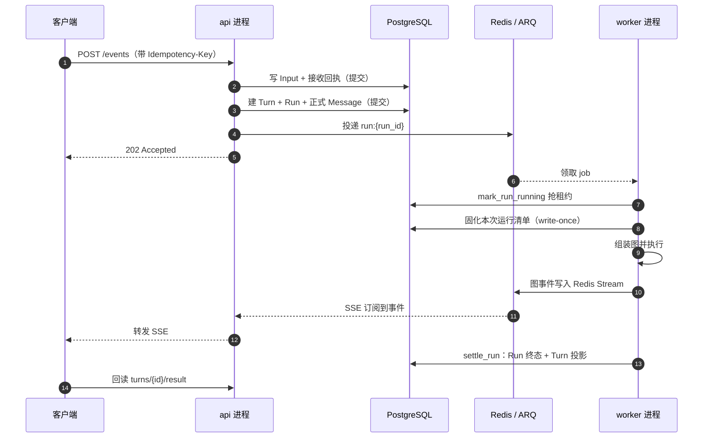

# 后端运行框架总览

> 读法：这一篇只讲功能，不追代码。先知道一条消息从进来到结束经过了哪几个人、每个人只对什么负责；细节留给后面的分站。
> 行号对应 v0.8.0.beta8(5c93360)，漂移时以函数名为准。

Yuxi 的后端不是"请求进来就同步跑完"，而是**先把意图持久化，再交给另一个进程去执行**。HTTP 请求只负责把输入和"要执行"这件事写进 PostgreSQL，真正的对话由独立的 worker 进程完成。

PostgreSQL 是唯一的事实来源，Redis 只承担三件短期的事：把 Run 投给 worker、把执行中的事件转给前端、把取消信号递给 worker。Redis 整个丢了也不会丢消息——因为"要做什么"已经写在 PostgreSQL 里，队列可以从数据库重建。

---

## 一、一条消息的完整生命周期

### 1. 接收 —— `202` 到底承诺了什么

api 校验身份与 `Idempotency-Key`，在**一个事务**里写入两样东西：输入的原始内容（Input）和"这次接收"的凭证（Receipt）。提交成功，就把 `202` 返回给客户端。

注意它**没有**承诺"开始执行了"，只承诺"已经可靠地收下，重试不会重复收"。真正的执行此刻还没开始。这是全系统最重要的一次语义约定：后面的所有补偿都以"提交了"为准。

### 2. 排队 —— 谁先谁后是数据库决定

收下的 Input 先是 `pending`。同一个会话里，普通消息按到达顺序排队；`steer`（"插一句话"）排在队头优先处理。判断顺序只看两个字段：类型和接收序号，不需要任何内存状态。

### 3. 派发 —— 把"待办"变成一个 Turn 和一个 Run

**在同一个 HTTP 请求里**，提交之后 api 立刻做第二件事：从队头领走这一批 Input，原子地创建 Turn（这一轮对话）、Run（这一次执行）、正式 Message（要发给模型的消息），然后再提交。

到这一步，数据库里已经有一条"排队中的执行"了。即使接下来进程崩溃，这条 Run 也不会消失。

### 4. 投递 —— 只是"提醒 worker 一下"

提交之后才把 Run 投进 ARQ 队列，job id 用 `run:{run_id}`，同一个 Run 在队列里只会有一份。

投递失败不回滚：Run 已经持久化了，恢复扫描会重新投递。所以"投递"是可重复的提醒，不是事实本身。

### 5. 领取 —— 抢租约，抢不到就退出

worker 拿到 job，第一件事是 `mark_run_running`：用一条带条件的更新把 Run 从 `pending` 改成 `running`，同时写入自己的 worker id 和租约到期时间。

如果更新影响 0 行，说明别的 worker 已经领走了（或这个 Run 已经终态），**静默退出**——这不是错误，是正常的竞态结果。

### 6. 准备 —— 先把"这次用什么跑"钉死

领取之后不急着跑模型，先做两件事：

- 构造运行上下文：解析 Agent、加载消息、校验会话与工作目录归属；
- 固化一份**运行清单**：配置摘要、Skill 内容、代码版本、消息清单指纹，写进数据库，并标记 write-once。

之后即使 Agent 配置被改，这一次 Run 也用当时钉死的那份。重试时必须与已持久化的清单一致，否则拒绝执行——保证"审计到的"和"实际跑的"是同一件事。

### 7. 执行与流式 —— 事件先落 Redis，终态以数据库为准

组装好的图开始执行，产出的事件写进 Redis Stream（按 Run 分键，带批量冲刷，避免逐条往返）。api 的 SSE 端点订阅这条流并转发给浏览器。

这里有一条硬规则：**Redis 里的事件是"快路"，PostgreSQL 里的终态才是权威**。Redis 丢事件，前端可以从数据库回放；数据库说没完成，Redis 说什么都不算。

### 8. 收尾 —— 一次事务里结算三样东西

执行结束，worker 用一个事务写：Run 的终态（completed / failed / interrupted / cancelled）、Turn 的投影状态、以及"这一轮的结果是哪个 Run"（`result_run_id`）。同时释放租约，最后才发终态事件。

前端收到终态后，回读 `turns/{turn_id}/result` 拿到最终输出。也就是说：**SSE 负责"知道结束了"，回读负责"拿到确定的结果"**。

---

## 二、阶段一览

| 阶段 | 谁在做 | 写下的事实 | 出错时谁补救 |
|---|---|---|---|
| 接收 | api | Input（pending）、Receipt | 客户端重试（幂等键保证不重复） |
| 排队 | 数据库 | 顺序、类型、优先级 | 无需补救，状态本身可查 |
| 派发 | api | Turn、Run（pending）、Message | 恢复扫描补投 |
| 投递 | ARQ / Redis | 一条队列消息 | 恢复扫描重投（可为空） |
| 领取 | worker | Run（running）、worker id、租约 | 租约过期判失败，不静默接管 |
| 准备 | worker | 运行清单（write-once） | 重试时校验指纹，不一致则拒绝 |
| 执行 | worker | 流式事件、消息、检查点 | 崩溃后按租约与检查点恢复 |
| 收尾 | worker | Run 终态、Turn 投影、result_run_id | 终态缺失会被判失败并暴露 |

---

## 三、三个"持久意图"

这套框架的稳定性来自三个可以被反复扫描的持久状态。只要它们在，进程挂了也能接着走：

1. **pending 的 Input**：收下了但还没派发。恢复扫描发现它就补一次派发。
2. **pending 的 Run**：登记了但还没被 worker 领走。重新投递即可，job id 保证不会投重。
3. **过期的租约**：`running` 但心跳停了。系统判定执行者失联，直接收敛成 `failed`（`error_type=worker_lease_expired`），**不会**让另一个 worker 悄悄接管——因为"跑到哪了、有没有副作用"已经无法确定。

对应的一句话：**没有"内存里的待办"，只有数据库里的待办。**

---

## 四、并发与水平扩展

- **api 无状态**：多副本随便加，它们只读写 PostgreSQL 和 Redis。
- **worker 有并发上限**：每个 worker 进程同时执行的任务数由 `ARQ_MAX_JOBS` 决定，默认 10。
- **任意 worker 能跑任意 Run**：执行需要的一切（输入内容、配置快照、运行清单）都在 PostgreSQL 里，不依赖领取它的那个进程的内存。
- **同一会话两条队列规则**：普通消息严格先进先出；`steer` 可以合并"连续就绪的一段"一起接管。

---

## 五、作业生命周期里的四个关键点

1. **执行参数不进队列消息**。队列里只有 `run_id`，参数以行形式存在数据库。这样消息体不会因为上下文变长而膨胀，也不会出现"消息里的参数和数据库不一致"。
2. **领取是原子的**。一条 `UPDATE ... WHERE` 就决定了唯一 owner，不需要分布式锁服务。
3. **心跳每 30 秒续租一次**（`RUN_HEARTBEAT_SECONDS`），租约有效期 120 秒（`RUN_LEASE_SECONDS`）。续不上就把自己当作失联，主动停止执行——宁可少跑，也不让两个 worker 同时写同一轮。
4. **取消走两路**。Redis 上的取消键让 worker 在 0.2 秒级别感知；数据库里的取消标记每秒兜底一次，保证 Redis 丢信号时取消仍然生效。

---

## 六、崩溃恢复

| 崩在哪 | 留下什么 | 谁来收拾 |
|---|---|---|
| api 提交 Input 后、派发前 | Input = pending | 恢复扫描补派发 |
| 派发后、投递前 | Run = pending | 恢复扫描重投 |
| worker 执行中 | Run = running，租约未续 | 租约过期判 `failed`，Turn 判失败，队列暂停 |
| worker 收尾前 | 终态已提交但清理未完成 | 清理责任持久化，下次执行先清理 |

重试有上限（`MAX_RUN_TRIES = 2`），业务执行超时单独控制（默认 3600 秒）。原则是**能从数据库重建的才自动恢复，不能确定的就显式失败**。

---

## 七、优雅关闭

- **api**：先把自己标记为"未就绪"（`/ready` 立即 503），再停 MCP、关 Redis/Neo4j/PostgreSQL。这样负载均衡不再往这个副本送新请求，已有的请求能收尾。
- **worker**：停止领取新 job；没跑完的 Run 不再续租，租约过期后由恢复逻辑接手。系统不要求"优雅地跑完"，只要求"不留模棱两可的状态"。

---

## 八、事件与回读

- **事件流**：每个 Run 一条 Redis Stream（`run:events:v2:{run_id}`），worker 写、api 读。
- **SSE 端点**：`GET /api/v1/agents/sessions/{id}/events`，支持游标续传；数据库里的事件用于补齐，Redis 只负责"实时"。
- **终态回读**：`GET .../turns/{turn_id}/result` 与 `.../items` 才是最终答案的来源。
- **一条经验**：排查"前端一直转圈"时，先看 SSE 有没有事件，再看数据库里 Run 是不是还 `running`，最后看租约——三者顺序就是"快路 → 事实 → 执行者"。

---

## 九、十二站地图

`docs/vibe/backend-onboarding.md` 第 4 章把代码阅读拆成 12 站，对应上面这些阶段：

| 站 | 内容 | 对应阶段 |
|---|---|---|
| 1 | HTTP 入口（`events.py`） | 接收 |
| 2 | 接收事务（`inputs.py`） | 接收 |
| 3 | 调度与派发（`scheduler.py`） | 排队 + 派发 |
| 4 | Worker 领取与租约（`runner.py`） | 领取 |
| 5 | 运行准备与 write-once 清单（`preparation.py`） | 准备 |
| 6 | 组装图（`execution.py`） | 执行 |
| 7 | 中间件栈 | 执行 |
| 8 | 工具从哪来 | 执行 |
| 9 | 一次模型调用的门控 | 执行 |
| 10 | 沙盒 | 执行 |
| 11 | 事件与终态 | 流式 + 收尾 |
| 12 | SSE 回读 | 流式 + 回读 |

前 5 站回答"消息怎么被可靠地接下并交出去"，后 7 站回答"这一轮对话具体怎么跑完"。

---

## 十、为什么这样拆

如果把执行放进 HTTP 请求里，会同时失去三样东西：

- **可靠性**：请求一断，执行就断；而这套设计里请求断了，Run 还在。
- **可恢复性**：进程崩溃后无从判断"跑到哪了"；现在每一步都有持久状态。
- **可扩展性**：api 和 worker 只能一起扩；现在可以按 CPU 型和 IO 型分别扩。

代价是链路变长、状态变多，所以每一段都必须能回答一个问题：**"这一步失败后，数据库里留下的是什么？"** 只要这个问题有答案，系统就能自愈。

---

## 十一、走一遍：五个具体场景

时间只用来示意先后，不代表真实延迟。

### 场景 1：一次正常问答

用户问"帮我总结这个 PDF"。

| 时刻 | 发生了什么 | 数据库里的状态 |
|---|---|---|
| 10:00:00.120 | 浏览器 POST，带 `Idempotency-Key: k-8f3a` | — |
| 10:00:00.150 | api 写 Input + Receipt | Input = pending，**还没有 Turn** |
| 10:00:00.180 | 同一请求内派发 | Turn T1 = running，Run R1 = pending，Message M1 |
| 10:00:00.210 | 投递 `run:R1` | 队列里多一个 job |
| 10:00:00.240 | 浏览器收到 `202` | 用户看到"已发送" |
| 10:00:00.260 | worker 领取 | R1 = running，worker = w-1，租约到 10:00:02.260 |
| 10:00:00.700 | 固化运行清单 | 配置、Skill、代码版本、消息指纹写死 |
| 10:00:00.900 | 第一条事件（开始思考） | Redis 里出现事件 → SSE 转发 |
| 10:00:06.000 | 模型流式输出 | 事件持续追加 |
| 10:00:12.400 | 调工具读 PDF（沙盒） | 工具开始/结束事件 |
| 10:00:24.100 | 结算 | R1 = completed，T1 = completed，result_run_id = R1，租约清空 |
| 10:00:24.200 | 前端回读 `turns/T1/result` | 拿到最终答案 |

这一次运行不到 30 秒，连一次心跳都不需要（租约 120 秒，心跳 30 秒一次）。

### 场景 2：用户中途插话（steer）

10:00:05，用户看着答案又发一句"顺便看看第二页"。

- **收下**：新 Input = pending，Receipt 写入，`202` 立刻返回。此时 Turn T1 还在 running，按默认模式这条是 `steer`。
- **不会打断模型**：worker 只在"安全边界"检查——两次模型调用之间、一次工具调用完成之后。
- **接管**：10:00:12.400 工具刚做完、准备下一次模型调用时，worker 发现队头有 steer，于是结算 R1（`yielded`），在同一个 Turn 里开 R2，把"第二页"这句并进去。
- **用户看到**：第一段回答完整收尾，然后接着回答第二页；不会出现半句话被截断。

排队细节：队列里依次是 `#1 steer`、`#2 普通消息`、`#3 steer`，本次会领走 `#1 #3`（连续的就绪 steer），`#2` 留到下一轮——普通消息不会插进这批 steer 中间。

如果 steer 带附件，附件还在 `preparing` 时不会被领走，否则模型会收到一个空附件。

### 场景 3：worker 进程被 `kill -9`

10:01:05，运维杀掉一个 worker。

- 它最后一次心跳在 10:00:30，租约到 10:02:30。
- 10:02:30 租约过期。
- 最多 30 秒后（恢复扫描每 30 秒一轮），系统判定失联：R1 = failed，`error_type = worker_lease_expired`；T1 = failed；队列暂停。
- 用户侧：SSE 先断，重连能回放；最终看到"执行失败"，而不是永远转圈。

**为什么不自动重试**：这一轮可能已经调过工具、发过邮件、改过文件。系统宁可判失败并把原因写清楚，让人决定要不要重来。

### 场景 4：api 在"提交了但还没派发"之间崩溃

- 数据库留下：Input = pending，没有 Turn，没有 Run。
- 最多 30 秒后，恢复扫描发现"这个会话还有 pending 输入"，补一次派发，正常开始。
- 用户可能连 `202` 都没收到（连接断了），刷新后这一轮自己开始了。

这条路径能成立，唯一的原因是——**接收和派发是两次提交**。

### 场景 5：网络重试同一条消息

- 浏览器超时，用同一个 `Idempotency-Key` 重发。
- api 查到已有回执：直接返回上一次的结果，不新建 Input，也不多跑一轮。
- 如果同一个 key 换了内容：`409`，因为"一个 key 只能对应一件事"。

---

## 相关文档

- [后端 onboarding 阅读指南](backend-onboarding.md)：按小时带读的完整路线
- [第一阶段总览](第一阶段总览.md)：API 进程的启动与请求入口
- [第二阶段总览](第二阶段总览.md)：一条消息如何被收下，并变成一轮
