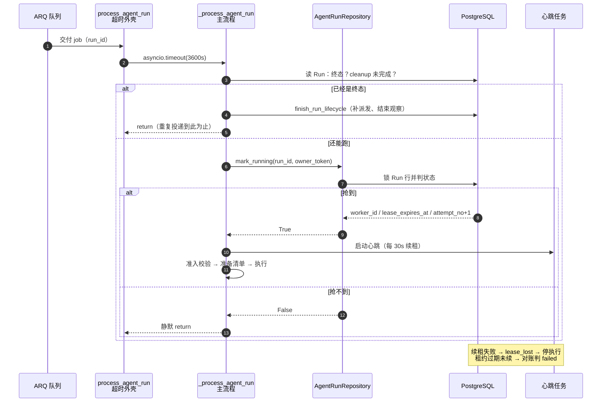
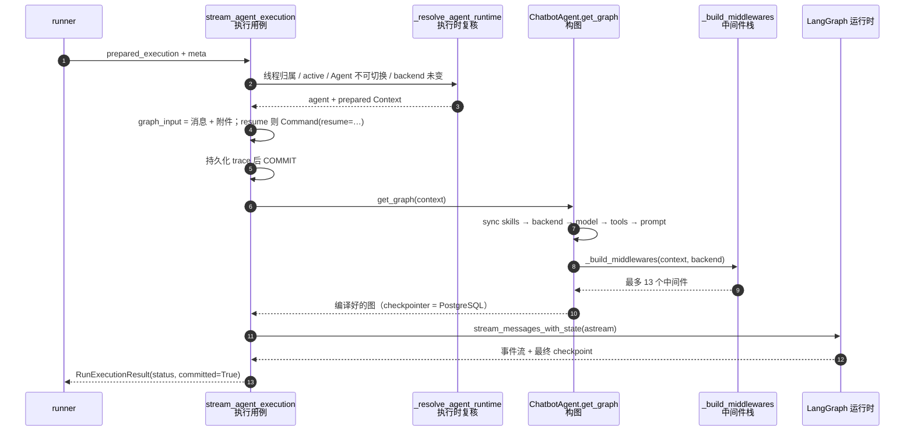

# 第三阶段总览：一条消息被领走，变成一次真正的执行

> 对应 `backend-onboarding.md` 第 8 节「第 2–4 小时」的后半段：第 4 章第 4–6 站（worker 领取与租约 → 运行准备与 write-once 清单 → 组装图）。
>
> 前置阅读：[第一阶段总览](./第一阶段总览.md)（进程分工、启动清单）、[第二阶段总览](./第二阶段总览.md)（消息怎么被收下、怎么变成 Turn/Run 并投递）。
>
> 读法：先看第 0 节拿结论；第 2 节补生词；第 4、5、6 节每节一张图加一张表；第 7 节是三个最容易说错的地方；第 8 节五题自测。

---

## 0. 一句话版本

**`deliver` 只负责把 `run:{run_id}` 放进队列；真正开工的是 worker：先原子地抢一张租约（回答「谁在跑」），抢到才准备并固化一份运行清单（回答「用什么跑」），最后组装图把模型流跑起来。抢不到就安静退出，租约过期就判失败——都不许「再试一把」。**

第二阶段的最后一格是「投递」：把 job 放进 ARQ。本阶段从 worker 真的取走这个 job 开始。

---

## 1. 本阶段要能回答的三个问题

| 问题 | 答案在哪 |
|---|---|
| 同一个 job 被 ARQ 投递两次，第二次会发生什么？ | 第 4.3、4.4 节 |
| 重试时能不能悄悄换模型、换配置？ | 第 5.4 节（write-once） |
| 为什么 backend 每次 `get_graph()` 都新建，而 provider 是进程级单例？ | 第 6.4 节 |

---

## 2. 术语补充

第一阶段（worker、ARQ、advisory lock）与第二阶段（幂等键、Receipt、Dispatch）的词不再重复，这里只补本阶段新出现的。

- **lease（租约）**：Run 行上的 `worker_id` + `lease_expires_at` 两列。它不是锁住整行不让人读，而是「此刻谁有权推进这个 Run，到几点为止」的声明。见 [`backend/yuxi/modules/agents/models/runs.py`](../../backend/yuxi/modules/agents/models/runs.py) 第 120-122 行。
- **owner token**：`{worker_id}:{uuid}`。同一个 worker 进程内 `worker_id` 稳定，但每次 job attempt 的 uuid 不同，所以「同一个人」和「同一次尝试」可以区分。见 [`backend/yuxi/modules/agents/services/runner.py`](../../backend/yuxi/modules/agents/services/runner.py) 第 384-386 行。
- **attempt（执行次数）**：`agent_run_attempts` 表的一行，`(run_id, attempt_no)` 唯一。每抢到一次所有权就 +1；失败、过期、重试都留痕。
- **心跳（heartbeat）**：执行期间每 30 秒续一次租约。续不上就说明所有权已经失效，当前执行必须停下。
- **对账（reconciliation）**：worker 每 30 秒跑一轮的扫描，专治「租约过期但 Run 还停在 running」这种失联状态。
- **admission（准入）**：抢到租约之后、真正构图之前的一串校验（输入形状、`run_type`、用户、工作目录归属）。不通过就判 failed，不进入模型。
- **manifest（运行清单）**：这个 Run「当时用什么智能体后端、什么模型、哪些工具/MCP/Skill、哪版代码」的摘要，write-once 固化在 Run 行上。
- **fingerprint / config_digest**：清单的 SHA-256 指纹，以及完整规范化配置的 SHA-256 摘要。指纹用于比对；摘要让 prompt 这类长文本不必逐字入清单也能发现变化。
- **write-once**：同一列只允许第一次写入；之后的重试只能**校验一致**，不能改写。
- **checkpoint_only**：`get_graph()` 的一条旁路，只为「已校验归属的取消服务」构造只含协作节点和通道的图，没有模型和工具。
- **中间件栈**：`create_agent(middleware=[...])` 的一串钩子。顺序就是语义，见第 6.3 节。

---

## 3. 三次交接

把「job 进队列」到「模型开始出字」切成三段，后面所有讨论都落在这张表里：

| 交接 | 谁把事实交给谁 | 哪里能看见 | 失败时 |
|---|---|---|---|
| 队列 → worker | ARQ 把 job 交给某个 worker 进程 | Redis 里的 job；at-least-once，可能重复 | 没人取走，job 留在队列 |
| 无主 → 有主 | `mark_run_running` 把 Run 行写上 owner 与到期时间 | `worker_id`、`lease_expires_at`、attempt 行 | 抢不到：静默退出 |
| 内存配置 → 行上事实 | manifest 固化（write-once） | `manifest`、`manifest_fingerprint` | 固化失败：判 failed，不执行 |

**记住一句话：抢租约回答「谁在跑」，固化清单回答「用什么跑」。** 两件事都完成，才允许 `get_graph()` 和模型请求。

---

## 4. 第 4 站：worker 领取与租约

这一站回答三个问题：job 被取走之后先做什么？「抢到」到底抢到了什么？抢不到、或者抢到之后失联了，系统怎么收场？

### 图：从 job 被取走到租约到手



### 图例：图里的每个节点是谁

| 节点 | 真实对象 | 职责 |
|---|---|---|
| `ARQ 队列` | Redis 中的 ARQ job | 只保证「至少投一次」，不保证不重复 |
| `process_agent_run` | [`runner.py:495`](../../backend/yuxi/modules/agents/services/runner.py) | 只包一层业务超时，把清理时间留给 ARQ 外层 |
| `_process_agent_run` | [`runner.py:501`](../../backend/yuxi/modules/agents/services/runner.py) | 读 Run、抢租约、准入、准备、执行、收尾 |
| `AgentRunRepository` | [`repositories/runs.py:394`](../../backend/yuxi/modules/agents/repositories/runs.py) | `mark_running` / `renew_lease` / `set_terminal_status` 的所有权校验 |
| `心跳任务` | [`runner.py:206`](../../backend/yuxi/modules/agents/services/runner.py) | 每 30 秒续租；续不上就置 `lease_lost` 并停止执行 |

### 4.1 入口只包一层超时

```python
# backend/yuxi/modules/agents/services/runner.py:495-498
async def process_agent_run(ctx, run_id: str):
    """在业务执行时限内运行，保留 ARQ 外层时间用于清理。"""
    async with asyncio.timeout(RUN_TIMEOUT_SECONDS) as execution_timeout:
        await _process_agent_run(ctx, run_id, execution_timeout)
```

`RUN_TIMEOUT_SECONDS` 默认 3600 秒（`YUXI_JOB_TIMEOUT_SECONDS`，[`runner.py:60`](../../backend/yuxi/modules/agents/services/runner.py)）。ARQ 的 `job_timeout` 比它多 30 秒（[`workers/settings.py:44`](../../backend/yuxi/workers/settings.py)），`func(...)` 的 timeout 也多 30 秒（[`workers/settings.py:28`](../../backend/yuxi/workers/settings.py)）——多出来的这半分钟专门留给「超时之后把话说清楚」：取消、结算、清理。

### 4.2 领活之前先看三件事

```python
# backend/yuxi/modules/agents/services/runner.py:503-529
    run = await _get_run(run_id)
    if not run:
        logger.warning(f"Run not found: {run_id}")
        return

    if run.status in TERMINAL_RUN_STATUSES:
        cleanup_was_pending = bool(getattr(run, "runtime_cleanup_pending", False))
        if cleanup_was_pending:
            await _require_runtime_cleanup(run, f"Run {run_id} 尚未完成 runtime cleanup")
            await publish_run_settlement(run_id, run.status, thread_id=run.thread_id)
        # cleanup 在独立事务释放责任；重读后复用正常执行的派发与观察收尾。
        current = await _get_run(run_id) if cleanup_was_pending else run
        if current is not None:
            await finish_run_lifecycle(current)
        logger.info(f"Run already terminal, skip: {run_id}, status={run.status}")
        return

    if bool(getattr(run, "runtime_cleanup_pending", False)):
        await _require_runtime_cleanup(run, f"Run {run_id} 尚未完成 retry runtime cleanup")
        run = await _get_run(run_id)
        if run is None:
            raise NonRetryableRunError(f"Run {run_id} 在 runtime cleanup 后不存在")

    worker_id = _run_owner_token(ctx)
    if not await mark_run_running(run_id, worker_id):
        logger.info(f"Run lease is owned elsewhere or expired, skip: {run_id}")
        return
```

三件事的顺序是有讲究的：

1. **先看终态。** 重复投递的第二份 job 如果来晚了，第一份已经跑完，这里直接补做「清租约后的收尾」（派发下一条输入、结束 Turn 的 observation），然后返回。
2. **再看清理责任。** 上一次 attempt 可能留下了没停干净的外部命令；`runtime_cleanup_pending` 为真时，必须先确认清理完成，才能重新领取。注意 `mark_running` 里也会拦这一条（[`repositories/runs.py:413-414`](../../backend/yuxi/modules/agents/repositories/runs.py)），这里是提前失败、给出更清楚的错。
3. **最后才抢租约。** 抢不到不是异常，是一句 `logger.info` 加 `return`。

### 4.3 租约到底在抢什么

```python
# backend/yuxi/modules/agents/repositories/runs.py:408-440
        run = await self._lock_run(run_id)
        if not run:
            return None, False
        if run.status in TERMINAL_RUN_STATUSES:
            return run, False
        if run.runtime_cleanup_pending:
            return run, False

        current_time = now or utc_now()
        initial_claim = run.status == "pending" or (run.status == "cancel_requested" and run.worker_id is None)
        same_live_owner = (
            run.status in LEASED_RUN_STATUSES
            and run.worker_id == worker_id
            and run.lease_expires_at is not None
            and run.lease_expires_at > current_time
        )
        if not initial_claim and not same_live_owner:
            return run, False

        if initial_claim:
            # Steer 接续可被提前补投；旧 Run 的环境必须先确认清理。
            if await self.has_thread_cleanup(run.thread_id):
                return run, False
            from yuxi.modules.agents.repositories.cooperation import CooperationRepository

            if not await CooperationRepository(self.db).claim_execution_slot(run):
                return run, False

        if run.status == "pending":
            run.status = "running"
        run.worker_id = worker_id
        run.heartbeat_at = current_time
        run.lease_expires_at = current_time + timedelta(seconds=lease_seconds)
```

判定只有两条正路，其余全部 `False`：

| 情况 | 条件 | 结果 |
|---|---|---|
| 首次领取 | `status == "pending"`，或 `cancel_requested` 且 `worker_id` 为空 | 改 running、写 owner、attempt +1 |
| 同一 owner 续接 | 有租约的状态、`worker_id` 相同、租约未过期 | 只续时间，attempt 不动 |
| 其他 | 上面两条都不满足 | 返回 `False` |

几个容易忽略的点：

- **`_lock_run` 用的是 `FOR KEY SHARE`（[`runs.py:967-970`](../../backend/yuxi/modules/agents/repositories/runs.py)）**，和第二阶段接收消息时同一类共享锁。它不负责把两个 worker 排队；真正让重复投递失败的是「状态机 + owner 校验」——第一份已经把 `status` 改成 `running`、`worker_id` 写成自己的 token，第二份再来时两条正路都不满足。
- **首次领取会开一条 attempt 记录**（[`runs.py:443-463`](../../backend/yuxi/modules/agents/repositories/runs.py)），同时把之前悬着的 attempt 以 `lease_expired` 收尾。以后查「这个 Run 被谁跑过几次」，看这张表。
- **重试不是「抢别人手里的 running Run」**。可重试异常发生时，`release_lease_for_retry` 把 Run 退回 `pending`、清空 owner 与租约、挂上 `runtime_cleanup_pending`（[`runs.py:509-541`](../../backend/yuxi/modules/agents/repositories/runs.py)），ARQ 的下一次 attempt 再走一遍「清理 → 首次领取」。`MAX_RUN_TRIES = 2`（[`runner.py:59`](../../backend/yuxi/modules/agents/services/runner.py)），最多两次。
- **参数都在代码里写死**：租约 120 秒（[`leases.py:22`](../../backend/yuxi/modules/agents/services/leases.py)）、心跳 30 秒（[`runner.py:69`](../../backend/yuxi/modules/agents/services/runner.py)）、单 worker 并发 10（`ARQ_MAX_JOBS`，[`workers/settings.py:19-21`](../../backend/yuxi/workers/settings.py)）。

### 4.4 抢不到为什么静默返回

ARQ 的投递语义是 at-least-once：worker 取走 job 之后崩溃、或者执行完但确认丢失，同一个 job 都可能被再投一次。`process_agent_run` 还显式关掉了结果保留（`keep_result=0`，[`workers/settings.py:28`](../../backend/yuxi/workers/settings.py)），队列里只留「还没确认的 job」这一份。

第二次进来的 worker 会看到 Run 已经有主。此时正确的动作就是**什么都不做**：

- 报错会让 ARQ 认为「这次执行失败」，触发重试；重试还是抢不到，白白制造噪音和 attempt 记录。
- 静默退出等于宣布「这个 Run 已经有人在跑，我让给他」，这正是期望行为。

### 4.5 失联：判失败，不接管

如果 owner 进程被 `kill -9`，心跳停了，租约到期后没人续。系统不会找另一个 worker「接着跑」，而是由对账把它收敛成一个**可观察的失败**。

```python
# backend/yuxi/modules/agents/repositories/runs.py:948-960
    @staticmethod
    def _expired_lease_condition(now: datetime):
        """候选读取与锁内复核共用同一失联判定。"""
        lease_expired = or_(AgentRun.lease_expires_at.is_(None), AgentRun.lease_expires_at <= now)
        return or_(
            and_(AgentRun.status == "running", lease_expired),
            and_(AgentRun.status == "cancel_requested", AgentRun.worker_id.is_not(None), lease_expired),
            and_(
                AgentRun.status == "cancel_requested",
                AgentRun.worker_id.is_(None),
                AgentRun.started_at.is_not(None),
            ),
        )
```

时间线（对账周期 30 秒，[`infrastructure/worker_health.py:17`](../../backend/yuxi/infrastructure/worker_health.py)；扫描入口 [`leases.py:81`](../../backend/yuxi/modules/agents/services/leases.py)）：

| 时刻 | 发生什么 |
|---|---|
| T+0 | 最后一次心跳成功，租约到 T+120s |
| T+30 | 应续租，但进程已死 |
| T+120 | 租约过期 |
| T+120～150 | 某一轮对账命中，Run 判 `failed` |
| 同一事务 | Turn 若仍指向这个 Run，判 `failed`；队列暂停；清 owner |

判失败时写下的字段很能说明态度（[`runs.py:570-578`](../../backend/yuxi/modules/agents/repositories/runs.py)）：

```python
run.status = "failed"
run.error_type = "worker_lease_expired"
run.error_message = "执行 worker 的 lease 已过期；本次运行结果未知，需按 at-least-once 语义检查副作用。"
run.runtime_cleanup_pending = True
```

**为什么不接管？** 因为「失联」不等于「没跑」。进程可能已经调用了模型、写了文件、发了请求；换个 worker 从 checkpoint 接着跑，等于让同一段副作用发生两次。所以这里选择：承认结果未知，判失败，把清理责任挂到 Run 上，让用户重发。

### 4.6 两个证明

这一站真正要建立的是两条「证明链」，缺一条就会出现「事件说完成了、库里还在跑」这类事故。

| 要证明的事 | 代码依据 | 反例 |
|---|---|---|
| 我确实持有所有权 | `mark_run_running` 返回 `True`，且 attempt 行归我 | 返回 `False` 还继续跑 → 双写 |
| 终态确实由我提交 | `set_terminal_status` 校验 `worker_id` + 租约未过期（[`runs.py:646-652`](../../backend/yuxi/modules/agents/repositories/runs.py)）；`completed` 还要求已绑定本 Run 的 assistant 输出消息（[`runs.py:656-661`](../../backend/yuxi/modules/agents/repositories/runs.py)） | 用别人的终态当自己的成功 |
| 执行结果与库一致 | 执行流交付 `RunExecutionResult` 后，runner 读回 Run 比对状态（[`runner.py:723-727`](../../backend/yuxi/modules/agents/services/runner.py)） | 事件说 completed，库里还是 running |

### 这站拥有什么事实

**此刻这个 Run 归谁、租约到几点、这是第几次 attempt。** 三个值都在 Run 行和 attempt 表里，重启进程也不会丢。

---

## 5. 第 5 站：运行准备与 write-once 清单

### 5.0 一句话

准备 = 把「入队时冻结的配置快照」变成一份可执行的 `Context`，再把它摘要成一行不可改写的 `manifest`。

| 步骤 | 做什么 | 产物 |
|---|---|---|
| 1 | 按当前用户重新确认 Agent 可见、后端存在 | `backend_id` |
| 2 | 用 Run 里的 `context_snapshot` 填 Context（只覆盖可配置字段） | `Context` 骨架 |
| 3 | `prepare_agent_runtime_context`：权限过滤后的工具、MCP、Skill、工作区提示 | 可执行的 `Context` |
| 4 | 组装 manifest、算指纹、write-once 固化 | `manifest` 行 |

### 5.1 一个事务里做两件事

```python
# backend/yuxi/modules/agents/services/preparation.py:50-74
async def prepare_and_record_run_execution(
    *,
    run: AgentRun,
    user: User,
    worker_id: str,
    workdir_binding: AuthorizedWorkdir,
) -> PreparedRunExecution:
    """在构图执行前固化运行清单与指纹；准备和固化失败由调用方收尾。"""
    async with pg_manager.get_async_session_context() as db:
        result = await prepare_run_execution(
            run=run,
            user=user,
            db=db,
            worker_id=worker_id,
            workdir_binding=workdir_binding,
        )
        fingerprint = compute_manifest_fingerprint(result.manifest)
        persisted_run, recorded = await AgentRunRepository(db).record_run_manifest(
            run.id,
            manifest=result.manifest,
            fingerprint=fingerprint,
            worker_id=worker_id,
        )
        _require_persisted_manifest_match(persisted_run, recorded=recorded, fingerprint=fingerprint)
        return result
```

注意：**清单固化失败，执行就不开始**。runner 会把这类失败包装成 `RunAdmissionRejected("manifest_persist_failed", ...)`（[`runner.py:606-617`](../../backend/yuxi/modules/agents/services/runner.py)），Run 直接判 failed。理由很简单：一个「说不清自己用什么配置跑」的执行，不许产生副作用。

### 5.2 Context 是怎么长出来的

```python
# backend/yuxi/modules/agents/services/preparation.py:181-201
    context = backend.context_schema()
    configured = run.input_payload.get("context_snapshot")
    if not isinstance(configured, dict) or not {"model", "tool_approval_mode"} <= configured.keys():
        raise ValueError("Run 缺少完整配置快照")
    configurable_fields = {item.name for item in fields(context) if item.metadata.get("configurable", True)}
    context.update_config(configured)
    context.update(
        {
            "tool_approval_mode": configured["tool_approval_mode"],
            "agent_slug": run.agent_slug,
            "thread_id": run.thread_id,
            "uid": str(user.uid),
            "run_id": run.id,
            "worker_id": worker_id,
            "runtime_scope_id": run.runtime_scope_id or run.thread_id,
            "workdir_relative_path": workdir_binding.workdir_path,
            "workdir_path": runtime_workdir_path(workdir_binding.workdir_path),
        }
    )
    configured_prompt = context.system_prompt
    context = await prepare_agent_runtime_context(context)
```

三个要点：

- **配置来自 Run，不来自请求现场。** `context_snapshot` 是接收阶段冻结在 `input_payload` 里的，worker 不重新读「当前设置」。这样「用户发消息之后又改了智能体配置」不会影响这条已经在排队的消息。
- **可配置字段白名单**：只有 `configurable=True` 的字段会被快照覆盖，身份类字段（`uid`、`run_id`、`worker_id`）由 worker 写入，模型和用户都改不了。
- **工作目录在这里绑定**：`workdir_relative_path` 来自执行器边界校验过的 `AuthorizedWorkdir`，之后沙盒命令只认这个路径。

### 5.3 manifest 里有什么

```python
# backend/yuxi/modules/agents/services/preparation.py:99-134
def build_manifest_payload(
    *,
    run_type: str,
    agent_slug: str,
    backend_id: str | None,
    model_spec: str | None,
    tool_approval_mode: str | None,
    normalized_context: dict,
    skill_entries: list[dict],
    code_revision: str | None,
    limits: dict,
) -> dict:
    """从已解析的执行资产组装 manifest；直接字段仅限稳定标识、摘要与关键 limit。

    limits 由调用方传入实际生效值（含 schema 默认值），不在此处解析。
    """
    return {
        "manifest_version": MANIFEST_SCHEMA_VERSION,
        "run_type": run_type,
        "agent": {
            "slug": agent_slug,
            "backend_id": backend_id,
        },
        "model": {
            "spec": model_spec if isinstance(model_spec, str) and model_spec else None,
        },
        "tool_approval_mode": tool_approval_mode,
        "resources": {
            "tools": _resource_keys(normalized_context.get("tools")),
            "mcps": _resource_keys(normalized_context.get("mcps")),
            "skills": skill_entries,
        },
        "limits": limits,
        "config_digest": compute_config_digest(normalized_context),
        "code_revision": code_revision or "unresolved",
    }
```

| 字段 | 内容 | 为什么进清单 |
|---|---|---|
| `manifest_version` | 当前为 2 | 结构可演进 |
| `run_type` | `chat` / `resume` | 复现入口 |
| `agent.slug`、`backend_id` | 谁、哪个后端 | 后端换了要能发现 |
| `model.spec` | 模型全名 | 换模型必须留痕 |
| `tool_approval_mode` | 审批模式 | 直接决定副作用要不要等人 |
| `resources.tools` / `mcps` / `skills` | 名字；Skill 还带版本与内容哈希 | 复现「当时能看到什么」 |
| `limits` | 5 个关键上限（[`preparation.py:32-38`](../../backend/yuxi/modules/agents/services/preparation.py)） | 影响行为 |
| `config_digest` | 完整配置的 SHA-256 | prompt 等长文本只留摘要 |
| `code_revision` | `YUXI_CODE_REVISION` 或 `unresolved` | 代码版本 |

**prompt 正文不进 manifest**，只以 `config_digest` 的形式存在。这是有意的：prompt 可能很长、可能含敏感内容，而「配置有没有变」只需要一个摘要就能回答。

### 5.4 write-once：重试只能原样复用

```python
# backend/yuxi/modules/agents/services/preparation.py:224-229
def _require_persisted_manifest_match(persisted_run: AgentRun | None, *, recorded: bool, fingerprint: str) -> None:
    """重试只能复用与 write-once manifest 完全一致的运行资产。"""
    if recorded:
        return
    if persisted_run is None or persisted_run.manifest_fingerprint != fingerprint:
        raise RuntimeError("运行资产已在重试前变化，与已固化 manifest 不一致")
```

| 情况 | `recorded` | 结果 |
|---|---|---|
| 首次执行 | `True` | 写入 manifest 与指纹 |
| 重试，配置一致 | `False` | 通过（复用已固化的事实） |
| 重试，配置变了 | `False` | `RuntimeError` → Run failed |

这条规则挡住的是「重试时偷偷换配置」：比如第一次跑用的是模型 A，失败后有人在后台把智能体改成模型 B，ARQ 重投时如果照新配置跑，这个 Run 的两次 attempt 就不是同一件事了。write-once 让第二次 attempt 只能校验「还是原来那份清单」，否则拒绝执行。

### 这站拥有什么事实

**「这个 Run 当时是用什么配置、哪版代码、哪些工具和 Skill 内容跑的」——一行不可改写、可审计的事实。**

---

## 6. 第 6 站：组装图（最重要的一站）

### 图：从 `stream_agent_execution` 到 `create_agent`



### 图例：图里的每个节点是谁

| 节点 | 真实对象 | 职责 |
|---|---|---|
| `stream_agent_execution` | [`execution.py:339`](../../backend/yuxi/modules/agents/services/execution.py) | 执行用例：复核归属、组装输入、构图、跑流、落库、交付结果 |
| `_resolve_agent_runtime` | [`execution.py:300`](../../backend/yuxi/modules/agents/services/execution.py) | 用「当前用户 + 当前库」复核这次执行仍然合法 |
| `get_graph` | [`graph.py:87`](../../backend/yuxi/modules/agents/runtime/agent_backends/chatbot/graph.py) | 每次调用新建模型、工具、中间件、图 |
| `_build_middlewares` | [`graph.py:33`](../../backend/yuxi/modules/agents/runtime/agent_backends/chatbot/graph.py) | 按固定顺序装配 13 个钩子 |
| `LangGraph 运行时` | `agent.stream_messages_with_state` | 跑图、产事件、写 checkpoint |

### 6.1 开工顺序：先复核、再提交、最后才进模型流

```python
# backend/yuxi/modules/agents/services/execution.py:372-382
        if is_resume:
            graph_input = Command(resume=resume_input)
            message_type = "resume"
        else:
            graph_input = [message.require_langchain_message() for message in input_messages]
            message_type = input_messages[0].message_type
            message_ids = [message.extra_metadata["message_id"] for message in input_messages]
            attachments = await AttachmentRepository(db).for_messages(message_ids)
            for position, message_id in enumerate(message_ids):
                visible = [serialize_attachment(item, thread_id=thread_id) for item in attachments[message_id]]
                graph_input[position] = _with_attachment_context(graph_input[position], visible)
```

```python
# backend/yuxi/modules/agents/services/execution.py:394-402
        try:
            await _persist_agent_run_langfuse_trace(db=db, meta=meta, run_context=langfuse_run)
            # 结束 runtime/附件/追踪准备事务后才进入模型流，禁用追踪也经过此提交点。
            await db.commit()
        except BaseException:
            await db.rollback()
            langfuse_run.terminal_status = "failed"
            finish_run_observation(langfuse_run)
            raise
```

顺序的含义：

- **执行时还要再复核一次。** `_resolve_agent_runtime` 检查 Thread 属于当前用户且 `active`、线程已绑定的 Agent 不许切换、Agent 后端与准备时一致（[`execution.py:309-325`](../../backend/yuxi/modules/agents/services/execution.py)）。准备阶段到执行阶段之间，配置可能被人改过。
- **先 COMMIT，再调模型。** 追踪、附件、工作目录这些准备事务在进入模型流之前提交；提交失败就回滚并标 failed，绝不出现「模型已经出字、库里没有这次执行的记录」。
- **`resume` 与 `chat` 走同一个流。** 前者输入是 `Command(resume=...)`，后者是消息列表 + 附件上下文。

### 6.2 `get_graph()` 每次都新建

```python
# backend/yuxi/modules/agents/runtime/agent_backends/chatbot/graph.py:95-119
            if not getattr(context, "_runtime_prepared", False):
                raise ValueError("构图需要已准备的 Context")
            await sync_agent_context_skills(context)
            backend = create_agent_composite_backend(context)
            model = load_chat_model(
                fully_specified_name=resolve_chat_model_spec(context.model),
                session_id=context.thread_id,
                uid=context.uid,
                max_retries=0,
            )
            tools = await resolve_configured_runtime_tools(context)
            prompt = build_prompt_with_context(context)
            middlewares = await _build_middlewares(context, backend)
        for tool in tools:
            if tool.name in context.middleware_tool_names and tool.name in context.mcp_tool_servers:
                server = context.mcp_tool_servers[tool.name]
                raise RuntimeError(f"工具名冲突：MCP '{server}' 的 '{tool.name}' 与 Backend 工具同名")
        return create_agent(
            model=model,
            tools=tools,
            system_prompt=prompt,
            middleware=middlewares,
            state_schema=ChatBotState,
            checkpointer=get_langgraph_checkpointer(pg_manager),
        )
```

四个细节：

- **`_runtime_prepared` 是准入标记**：没有经过 `prepare_agent_runtime_context` 的 Context 直接构图会抛错，防止绕过第 5 站。
- **`sync_agent_context_skills` 每次刷新 Skill 投影**：把 Skill 内容投影到工作目录。清单里记的是**准备阶段**的内容哈希，所以两次 attempt 之间如果有人改了 Skill 内容，第二次准备会因指纹不一致被拒（第 5.4 节）。
- **工具名冲突直接抛**：MCP 工具和 Backend 内置工具同名时，模型无法区分该调谁，这里选择 fail-closed。
- **checkpointer 永远是 PostgreSQL**：没有本地文件后端，也没有静默降级。

### 6.3 中间件栈：顺序就是语义

`_build_middlewares` 返回的列表顺序（[`graph.py:33-79`](../../backend/yuxi/modules/agents/runtime/agent_backends/chatbot/graph.py)）：

| # | 中间件 | 作用 | 是否总在 |
|---|---|---|---|
| 1 | `ToolErrorGuardMiddleware` | 最外层隔离普通工具异常，保留取消与 interrupt | 是 |
| 2 | `SteerMiddleware` | 在安全检查点让位 steer | 是 |
| 3 | `create_agent_filesystem_middleware` | 工具结果驱逐预算；虚拟文件系统走 CompositeBackend | 是 |
| 4 | `SkillsMiddleware` | Skill 内容注入 | 是 |
| 5 | `create_memory_middleware` | 长期记忆 | 视配置 |
| 6 | `create_cooperation_middleware` | 协作子任务 | 视配置 |
| 7 | `create_summary_middleware_from_context` | 上下文压缩 | 是 |
| 8 | `PatchToolCallsMiddleware` | 修补工具调用参数（deepagents） | 是 |
| 9 | `NetworkRetryMiddleware` | 网络错误与普通重试预算合并处理 | 是 |
| 10 | `create_tool_approval_middleware` | 工具审批等待点 | 视模式 |
| 11 | `RuntimeAuthorizationMiddleware` | 运行期授权（工具/资源可见性） | 是 |
| 12 | `ImageInputCompatibilityMiddleware` | 模型不支持图片时的回退 | 是 |
| 13 | `TokenUsageMiddleware` | 统计真正发给 provider 的请求 | 是 |

顺序里藏着两条关键约束，注释都写在代码里：

- **第 1 个在最外层**：「最外层隔离普通工具异常，保留取消与 interrupt 的传播」（[`graph.py:36`](../../backend/yuxi/modules/agents/runtime/agent_backends/chatbot/graph.py)）。
- **第 10、11 个的先后是反的**：「`after_model` 按逆序执行，授权必须先于审批产生等待点」（[`graph.py:72`](../../backend/yuxi/modules/agents/runtime/agent_backends/chatbot/graph.py)）。也就是说，列表里审批在前、授权在后，实际执行时授权先跑——先确认「这个工具你能不能用」，再决定「要不要弹审批」。如果反过来，用户会为一个本来无权使用的工具白白等一次审批。

### 6.4 为什么 backend 新建、provider 单例

| 每次 `get_graph()` 新建 | 进程级共享 |
|---|---|
| `Backend`（`CompositeBackend`）：绑定本次 Run 的工作目录、沙盒身份、token 限额 | `SandboxProvider`：模块级 `_sandbox_provider` 单例（[`sandbox/provider.py:15-31`](../../backend/yuxi/modules/agents/runtime/sandbox/provider.py)） |
| `model` 实例：绑定 `session_id`、`uid`、`max_retries=0` | `model_cache`：模型元数据缓存（不是模型实例） |
| `graph`：中间件、工具、prompt 都是本次 Run 的组合 | PG 连接池、Redis client、LangGraph checkpointer |

判断标准很简单：**绑定「这一次 Run 的身份与路径」的东西必须每次新建**（否则不同用户/不同会话会串），**管理进程级资源的东西必须单例**（否则连接池和容器池会被打爆）。

### 6.5 `checkpoint_only` 旁路

`get_graph(checkpoint_only=True)` 用 `CheckpointCleanupModel` 代替真模型，工具列表为空，`_build_middlewares` 传 `cleanup_model`（[`graph.py:89-93`](../../backend/yuxi/modules/agents/runtime/agent_backends/chatbot/graph.py)）。它只保留协作节点和持久 checkpoint 的通道，供「归属已经校验过的取消服务」调 LangGraph 的状态 API——不需要跑模型，但需要图的结构一致。

### 这站拥有什么事实

**「这一次 Run 的执行装配结果」**：用哪个模型、哪些工具、哪些中间件、什么 checkpoint 命名空间。它是执行时的一次性产物，不缓存、不进 manifest（manifest 记的是输入侧的事实，图是输出侧的实现）。

---

## 7. 三个最容易说错的地方

| 容易说成 | 实际是 |
|---|---|
| 租约过期后，另一个 worker 会接手继续跑 | 不会。对账判 `failed`（`worker_lease_expired`），挂上 `runtime_cleanup_pending`，等用户重发 |
| 抢不到租约会重试，直到抢到为止 | 不会。静默 `return`；重试只由 ARQ 的 job 重投触发，且 `MAX_RUN_TRIES = 2` |
| manifest 是缓存，随时可以重算 | 不是。write-once；重试时指纹不一致直接拒绝执行 |
| provider 和 backend 一样，每次执行新建 | provider 是模块级单例；backend（以及 graph、model 实例）才每次新建 |

---

## 8. 五分钟自测

<details>
<summary>Q1：同一个 job 被 ARQ 投递两次，第二次会发生什么？分两种情况说。</summary>

- 第一份已经跑完：第二次在 `_process_agent_run` 开头命中 `TERMINAL_RUN_STATUSES` 分支，补做 `finish_run_lifecycle`（清取消信号、派发下一条输入、结束 observation），然后 return。
- 第一份还在跑：第二次走到 `mark_run_running`，Run 已经是 `running` 且 owner 不是自己，返回 `False`，打一行 info 日志后 return。

两种都不会报错，也都不会让两个 worker 同时推进同一个 Run。
</details>

<details>
<summary>Q2：worker 在 T+0 被 kill -9，用户什么时候看到失败？看到的是什么？</summary>

- 心跳每 30 秒一次，租约 120 秒；最后一次心跳在 T+0，租约到 T+120s 过期。
- 对账每 30 秒一轮，所以最晚 T+150s 左右命中。
- 用户看到的是：Run `failed`、`error_type = worker_lease_expired`、Turn `failed`、队列被暂停（`queue_paused`）。错误文案明确写「结果未知，需按 at-least-once 语义检查副作用」。
</details>

<details>
<summary>Q3：第一次 attempt 用模型 A 失败，重试前有人把智能体改成模型 B，会怎样？</summary>

- 第 5 站准备时按新配置生成 manifest，指纹与已固化的不同。
- `_require_persisted_manifest_match` 抛 `RuntimeError("运行资产已在重试前变化，与已固化 manifest 不一致")`。
- Run 判 failed，不会用模型 B 跑第二次。这是 write-once 在起作用。
</details>

<details>
<summary>Q4：中间件列表里「审批」在「授权」前面，为什么实际执行时授权先跑？</summary>

- LangChain 的 `after_model` 钩子按列表逆序执行。
- 列表顺序是「… → 审批 → 授权 → …」，逆序执行时授权先跑。
- 代码注释写明了原因：授权必须先于审批产生等待点，避免为无权使用的工具弹一次无意义的审批。
</details>

<details>
<summary>Q5：为什么 `Backend` 每次 `get_graph()` 新建，而 `SandboxProvider` 是单例？</summary>

- `Backend` 绑定本次 Run 的工作目录、沙盒执行身份、工具 token 预算；不同 Run 之间不能共享，否则路径和身份会串。
- `SandboxProvider` 管理的是容器/远端沙盒这类进程级资源，单例才能复用连接池与清理逻辑。
- 一句话：**身份相关的每次新建，资源相关的进程共享。**
</details>

---

## 9. 对象对照表

| 名字 | 是什么 | 谁写 | 活多久 |
|---|---|---|---|
| `AgentRun` 行 | 一次执行段 | `claim_next_input`（第二阶段） | 到终态 |
| `worker_id` + `lease_expires_at` | 当前 owner 与到期时间 | `mark_running` / `renew_lease` | 到终态或租约过期 |
| `AgentRunAttempt` 行 | 第几次执行、谁跑的、怎么结束的 | `mark_running` / `_finish_open_attempt` | 永久（审计） |
| `manifest` + `manifest_fingerprint` | 用什么配置跑 | `record_run_manifest`（write-once） | 永久 |
| `Context` | 本次执行的内存态配置 | `prepare_run_execution` | 一次 attempt |
| `graph` | 模型 + 工具 + 中间件 + checkpointer | `get_graph` | 一次 attempt |
| `checkpoint` | LangGraph 的持久状态 | 运行时（PostgreSQL） | 随会话 |
| `RunExecutionResult` | 「我提交了哪个终态」的交付物 | `stream_agent_execution` | 一次执行流 |

---

## 10. 三个常见误解

1. **「worker 是常驻执行者，会一直盯着某个 Run」**：不是。worker 是 ARQ 进程，每次取一个 job；执行期间靠心跳维持所有权，进程没了所有权就没了。
2. **「租约是行锁，锁住别人不能读」**：不是。它是 Run 行上的两个普通字段；读永远不受影响，它约束的是「谁能写终态」。
3. **「checkpoint 是运行时缓存，丢了重跑就行」**：不是。checkpoint 是恢复对话与中断续跑的状态事实，和 Run 的业务终态是两套东西；Run 是否完成只看 `status` 与 `result_run_id`，不看 checkpoint。

---

## 11. 下一站

第 7 站进入 harness 的主体：中间件栈逐层拆解（第 5–8 小时，第 7–10 站）。本阶段只需要记住：**图是每次新建的，中间件的顺序是语义的一部分**，第 7 站会把这张表逐行展开。
