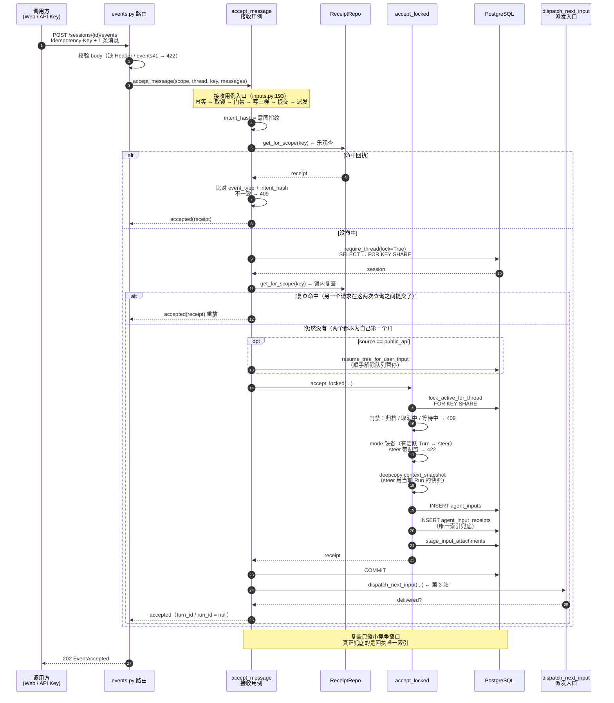
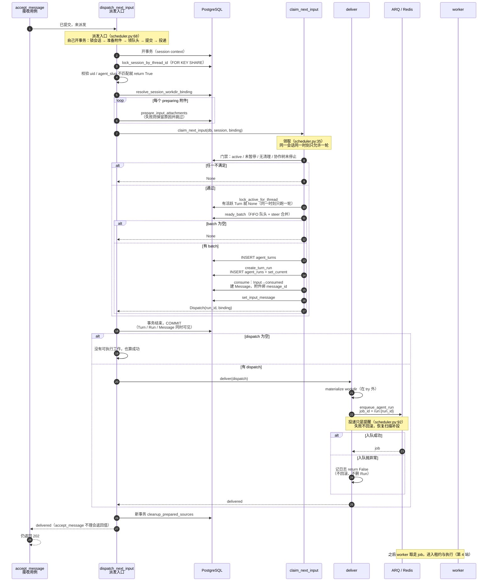

# 第二阶段总览：一条消息被收下，并变成一轮

> 对应 `backend-onboarding.md` 第 8 节的「第 2 小时」：第 4 章第 1–3 站（路由 → `accept_message` → 派发与领取）。
>
> 前置阅读：[第一阶段总览](./第一阶段总览.md)（进程分工、中间件、启动清单）。
>
> 读法：先看第 0 节拿结论；第 2 节补生词；然后按第 4、5、6 节的顺序走，每节都是一张时序图加一张表；第 7 节是上一轮核查纠正过的说法，第 8 节自测。

---

## 0. 一句话版本

**一条消息要过三道关：路由把形状看对（202 / 422）、用例把它原子地「收下并记账」（Input + Receipt）、调度把它变成 Turn/Run 再投递（提交之后才入队）。三道关的分界线是一次 COMMIT。**

`docs/vibe/backend-onboarding.md` 第 4 章的流程图把这叫「收下」，本文件就讲「收下」这两个字背后的全部动作。

---

## 1. 本阶段要能回答的三个问题

| 问题 | 答案在哪 |
|---|---|
| 用户点一次发送，服务端到底写了哪几张表？ | 第 5 节（`accept_message`）与第 9 节（对象对照表） |
| 为什么 202 里 `turn_id`、`run_id` 是 null，前端怎么知道开始跑了？ | 第 5.4 节 |
| Redis 挂了消息会不会丢？为什么先提交再入队？ | 第 6 节（`dispatch_next_input`）与第 10 节 |

---

## 2. 术语补充

第 1 小时的术语（worker、ARQ、advisory lock 等）在[第一阶段总览 §2](./第一阶段总览.md) 里，这里只补本阶段新出现的词。

- **Idempotency-Key（幂等键）**：请求头里的字符串，长度 1..128，作用域是「用户 + APP + Thread」。同一个 key 再发一次，系统不重复收，只把上一次的**回执**原样返回。定义在 [`backend/yuxi/modules/agents/receipts.py`](../../backend/yuxi/modules/agents/receipts.py) 第 8-11 行。
- **intent_hash（意图指纹）**：把「这次到底想干什么」序列化后取哈希（事件类型、模式、模型、消息、附件……）。同 key 不同指纹 = 你在拿同一个编号干另一件事，系统会拒绝。见 [`backend/yuxi/modules/agents/receipts.py`](../../backend/yuxi/modules/agents/receipts.py) 第 14-16 行。
- **Receipt（接收回执）**：一张独立的表 `agent_input_receipts`，记录「这个 key 已经收过什么」。它不是消息本身，而是**幂等的账本**。
- **乐观查 / 锁内复查**：先不加锁查一次回执（快路径，重试直接命中），拿锁后再查一次（防两个请求同时写）。这两次查询是第 5 节时序图里最关键的两根线。
- **202 Accepted**：HTTP 语义是「已接收、处理尚未完成」。MDN 的说法是 deliberately non-committal——服务端不承诺处理结果，只承诺收下了。所以 202 的正文只描述「接收事实」，不描述「执行状态」。
- **follow_up / steer**：两种输入模式。`follow_up` 按 FIFO 排队；`steer` 优先，在安全边界接管当前 Run。不指定时：有活跃 Turn → `steer`，空闲 → `follow_up`，协作等待 → 排队。
- **优先队头**：队列不是纯 FIFO。排序是「`resumes_queue` 的输入最先 → `steer` 优先 → 其余按收到顺序」，见 [`backend/yuxi/modules/agents/repositories/input.py`](../../backend/yuxi/modules/agents/repositories/input.py) 第 59-68 行。
- **Dispatch**：`claim_next_input` 的返回值，装着 `run_id` 和 workdir 绑定。它代表「已提交的、等投递的一次执行」。

---

## 3. 三个时间边界

把整个请求切成三段，后面所有讨论都落在这张表里：

| 边界 | 谁在动 | 数据库里能看见 | 客户端看到 |
|---|---|---|---|
| 提交前 | 路由校验、回执查询、意图指纹 | 什么都没有 | 还在等响应 |
| 提交中 | `accept_locked` 写 Input + Receipt + 附件绑定 | 本事务内可见，别人看不见 | 还在等响应 |
| 提交后 | `dispatch_next_input` 建 Turn/Run、入队 | 所有人可见；未投递的 Run 是 `pending` | 拿到 202 |

**记住一句话：202 是在「提交后」发出，而不是在「入队后」。** 入队失败不影响 202，因为事实已经在库里了。

---

## 4. 第 1 站：路由只做三件事

路由不碰业务，只负责：接住形状、校验、转交给用例。

```python
# backend/yuxi/api/routers/public_v1/agents/events.py:35-58
@router.post("/sessions/{session_id}/events", status_code=202, summary="提交消息或控制事件", response_model=EventAccepted)
async def submit_public_event(
    session_id: str,
    payload: SessionEventCreate,
    idempotency_key: str = Header(..., alias="Idempotency-Key"),
    context: PublicAgentContext = Depends(require_public_context),
    db: AsyncSession = Depends(get_db),
):
    """一次提交一个输入事件，可包含多条有序用户消息。

    202 仅证明持久接收。相同会话、幂等键和意图可重试；改变意图返回 409。
    普通消息在运行中默认 steer，空闲默认 follow_up；等待回答/审批时返回 409。
    显式 follow_up 按 FIFO 排队，Turn/Run ID 在消费时绑定。
    cancel 仅暂停已有待办；新用户消息优先恢复目标队列，重放不再次恢复。
    恢复、审批、队列及协作控制使用 yuxi.* 扩展。
    """
    result = await submit_thread_event(
        db=db,
        scope=context.scope,
        thread_id=session_id,
        event=payload.events[0],
        idempotency_key=idempotency_key,
    )
    return event_receipt(result)
```

错误契约不在这个函数上，而在 router 级：`events.py:32` 把 `responses=PUBLIC_ERRORS` 挂在整组路由上。

### 4.1 三种「不合法」分属三层

| 情况 | 谁拒绝 | 状态码 |
|---|---|---|
| 缺 `Idempotency-Key`、`events` 不是 1 条、JSON 形状不对 | FastAPI 校验层（Pydantic） | **422** |
| 业务参数不合法（空消息、`steer` 带配置） | `InvalidInputError` | **422** |
| Thread 不存在或不属于你 | repository 可见性查询 | 404 |
| 状态不允许（归档、取消中、key 撞了别的意图） | `DomainError` 处理器 | 409 |

注意 422 有两个来源：校验层和 `InvalidInputError`。它们同码不同义——前者是「形状不对」，后者是「形状对但业务上不允许」。

`DomainError` 到 HTTP 状态的映射在 [`backend/yuxi/api/errors.py`](../../backend/yuxi/api/errors.py) 第 23 行：`StateConflictError: 409`。API 只注册了这一个异常处理器（[`backend/yuxi/api/main.py`](../../backend/yuxi/api/main.py) 第 109 行），所以后文提到的**未捕获异常都会变成 500**，这一点很关键。

> ⚠️ 更正：`backend-onboarding.md` 第 2 站流程图里写「缺 Header → 400」，实际是 Pydantic 校验失败的 **422**。

### 4.2 一个端点，七种事件

请求体里 `events` 是长度为 1 的数组，元素类型决定去哪。[`backend/yuxi/api/routers/public_v1/agents/events.py`](../../backend/yuxi/api/routers/public_v1/agents/events.py) 第 61-110 行就是一个纯分派器：

| 事件类型 | 去向 | 干什么 |
|---|---|---|
| `TreeControl` | `control_tree` | 暂停 / 恢复整棵协作树 |
| `Message` | `accept_message` | 接收一条用户消息（本阶段主角） |
| `Resume` | `resume_turn` | 回答等待点、批准工具调用 |
| `Cancel` | `cancel_turn` | 取消某一轮 |
| `Continue` | `continue_queue` | 继续排队输入 |
| `CancelInput` | `cancel_input` | 取消还没被领取的输入 |
| `PromoteInput` | `promote_input` | 提升排队中的输入 |

### 4.3 回执长什么样

```python
# backend/yuxi/api/routers/public_v1/agents/schemas.py:297-306
class EventAccepted(BaseModel):
    """仅证明事件持久接收的 Yuxi 扩展回执。"""

    object: Literal["yuxi.session.event.accepted"] = "yuxi.session.event.accepted"
    event_id: str
    session_id: str
    input_id: str | None = None
    turn_id: str | None = None
    run_id: str | None = None
    status: Literal["accepted"] = "accepted"
```

字段名就叫 `accepted`，不叫 `ok`、不叫 `running`——这张表只表达「收下了」。

---

## 5. 第 2 站：`accept_message` —— 把消息收下

主角是 [`backend/yuxi/modules/agents/services/inputs.py`](../../backend/yuxi/modules/agents/services/inputs.py) 第 193-269 行。



### 图例：图里的每个节点是谁

| 图里的节点 | 真实位置 | 它只负责什么 |
|---|---|---|
| `events.py 路由` | `api/routers/public_v1/agents/events.py:36` | 薄路由：校验 body、按事件类型分派，不写业务、不开事务 |
| `accept_message` | `services/inputs.py:193-269` | 接收用例的总入口：幂等 → 取 Thread 锁 → 门禁 → 写 Input/回执/附件 → 提交 → 调派发 |
| `ReceiptRepo` | `repositories/input_receipt.py` | 只读写回执：乐观查一次、锁内再查一次 |
| `accept_locked` | `services/inputs.py:322-415` | 假定调用方已持锁的写库段：门禁、冻结配置、写三样 |
| `dispatch_next_input` | `services/scheduler.py:68-89` | 提交之后才调的派发入口（第 6 节展开） |
| `PostgreSQL` | 数据库 | 唯一事实来源；"收下了"以它提交为准 |

### 5.1 八步逐条

| 步 | 动作 | 位置 |
|---|---|---|
| 1 | 校验幂等键长度 | `inputs.py:211` → `receipts.py:8-11` |
| 2 | 算意图指纹 | `inputs.py:217-227` |
| 3 | 乐观查回执 | `inputs.py:228-232` |
| 4 | 取 Thread（带锁） | `inputs.py:234` → `thread_access.py:14` |
| 5 | 拿锁后再查一次回执（复查） | `inputs.py:235-238` |
| 6 | 锁内落库（Input / Receipt / 附件） | `inputs.py:246` → `accept_locked` `inputs.py:383-411` |
| 7 | 提交 | `inputs.py:267` |
| 8 | 提交后派发 | `inputs.py:268` |

### 5.2 幂等的三种情况

| 情况 | 返回 | 写入行数 |
|---|---|---|
| 同 key，内容一模一样 | 202，回执与第一次逐字段相同 | 不新增 |
| 同 key，内容改了一个字 | 409「Idempotency-Key 已用于其他输入」 | 不新增 |
| 新 key | 202，新回执 | Input + Receipt 各 1 行 |

第二条的判定就是 `require_receipt_replay`（[`backend/yuxi/modules/agents/receipts.py`](../../backend/yuxi/modules/agents/receipts.py) 第 24-27 行）；集成测试里也直接断言了这个行为（[`backend/test/integration/api/test_domain_error_contract.py`](../../backend/test/integration/api/test_domain_error_contract.py) 第 116 行）。

### 5.3 跟着图走：从「没命中」开始

时序图里那条 `alt 命中回执 / else 没命中` 的分叉，问的是「第一次查回执有没有查到」。命中就原样重放；**没命中**则进入下半段，下面每一格都在回答「那接下来做什么」。

拿取件码打比方：柜台系统里没有记录，店员得去货架把包裹取来，再登记。

**取 Thread 并加锁**（`require_thread(lock=True)`）

后面要读这个会话的状态（归档没有、协作树停没停），所以先把会话读出来并锁住。锁是 `FOR KEY SHARE`（[`backend/yuxi/modules/agents/repositories/sessions.py`](../../backend/yuxi/modules/agents/repositories/sessions.py) 第 109-115 行）：共享锁，两个接收请求可以同时持有，它只防止别的事务删除会话或改主键，**不是排队**。

**复查回执**（`alt 复查命中 / else 仍然没有`）

从「取件」回来，再查一次回执：

- **复查命中**：上一次查询与这一次之间，另一个同 key 的请求已经提交了 → 比对 `intent_hash` 后直接返回它的回执（内容不符则 409）。
- **仍然没有**：到这一刻确实没人写过 → 继续往下。
- **真并发**：两个请求都两次查空（两次查询都发生在对方提交之前），于是都往下走、都插入；这时唯一索引 `uq_agent_input_receipts_scope_key`（[`backend/yuxi/modules/agents/models/inputs.py`](../../backend/yuxi/modules/agents/models/inputs.py) 第 136-144 行）让后提交的那条失败（`23505`）。今天这个失败没人接，会变成 500；数据本身仍然只有一份，输家整个事务回滚，什么都不留（第 7 节）。

**顺手解除队列暂停**（`opt source == public_api`）

公开 API 收到新消息时会调 `resume_tree_for_user_input`（[`inputs.py`](../../backend/yuxi/modules/agents/services/inputs.py) 第 240-245 行）：协作树若被暂停就记下 `resume_queue`，提交后再把 `queue_paused` 置回 False。重放不会走到这里，所以不会重复解除。

**锁内接收**（`accept_locked`）

写库前先过门禁（完整表格在 5.4）：归档、取消中、等待回答/审批 → 409；`steer` 带模型或审批配置 → 422。然后按缺省规则定 `mode`（有活跃 Turn → `steer`，否则 `follow_up`），`deepcopy` 冻结 `context_snapshot`，接着写三样：`agent_inputs`、`agent_input_receipts`、附件绑定（`stage_input_attachments`）。

**COMMIT**

从这一刻起这件事对所有人可见——202 的前提就是它成功。

**派发**（`dispatch_next_input`，箭头指向第 6 节）

提交之后才派发。即使入队失败，202 也已经成立，补偿靠 `recover_pending_dispatches`（第 6 节）。

**返回 accepted**

`turn_id` / `run_id` 为空，因为 Turn/Run 还没建（5.4）。

### 5.4 锁内门禁与回执

进了 `accept_locked`，第一件事是过门禁：

| 条件 | 结果 |
|---|---|
| Thread 已归档 | 409 |
| 当前 Turn 正在 `cancelling` | 409 |
| 当前 Turn `waiting` 且不是协作等待（等用户答话 / 等审批） | 409 |
| 协作等待中却指定 `steer` | 409 |
| `steer` 同时带 `model` 或 `tool_approval_mode` | 422（要改配置就得排队） |
| 其余 | 正常接收 |

**锁和门禁的关系**：这几道判断都在两次回执查询之后、真正写库之前执行（`accept_locked` 内部）。门禁回答的是「这个会话此刻允不允许接收」，**不负责去重**——去重是 5.3 讲的事。这里加的锁同样是 `FOR KEY SHARE`，两个接收请求可以同时持有，所以门禁不会把并发的接收请求排成队，它只是各自读一眼当时的状态再决定放不放行。门禁抛 409/422 时事务尚未提交，不会留下半条数据。

门禁在 [`backend/yuxi/modules/agents/services/inputs.py`](../../backend/yuxi/modules/agents/services/inputs.py) 第 343-351 行；模式缺省规则在同一段第 353 行。

**收下之后：回执里为什么没有 `turn_id` / `run_id`**

门禁决定「收不收」；收下之后写进回执的，是**这次接收**本身，而不是执行结果。所以 `accept_locked` 返回的回执里只有 `input_id`、`receive_seq` 这些接收信息，`turn_id` / `run_id` 是空的——这条消息此刻只是一个**待办**，还没有轮到它执行。Turn/Run 要等到派发时才建（第 6 节），而且可能排在别人后面。前端想知道「什么时候开始跑」，应该看 SSE 事件流或 `GET /sessions/{id}` 的 `current_turn`，而不是等 202 的响应体。

数据层也强制了这一点：回执表的约束 `ck_agent_input_receipts_target` 规定「挂了 `input_id` 就不能再挂 `turn_id/run_id`」（[`backend/yuxi/modules/agents/models/inputs.py`](../../backend/yuxi/modules/agents/models/inputs.py) 第 134 行），代码里也没有事后回填。

---

## 6. 第 3 站：`dispatch_next_input` → `claim_next_input` → `deliver`

主角是 [`backend/yuxi/modules/agents/services/scheduler.py`](../../backend/yuxi/modules/agents/services/scheduler.py)：派发 `:68-89`、领取 `:35-65`、投递 `:92-103`。



### 图例：图里的每个节点是谁

| 图里的节点 | 真实位置 | 它只负责什么 |
|---|---|---|
| `accept_message` | `services/inputs.py:193` | 上一站的主角；它提交之后调用派发，**不看返回值**，照样返回 202 |
| `dispatch_next_input` | `services/scheduler.py:68-89` | 派发编排：自己开事务、锁会话、准备附件、领队头、提交、投递 |
| `claim_next_input` | `services/scheduler.py:35-65` | 领队头：六道闸门 + 建 Turn/Run/Message，都在同一个事务里 |
| `deliver` | `services/scheduler.py:92-103` | 投递：materialize 工作目录 + 入队；入队失败只记日志 |
| `ARQ / Redis` | 队列 | 只负责"叫醒 worker"，不是事实来源；丢了可以重建 |
| `worker` | `workers/` | 取走 job，进入第 4 站的租约与执行 |

### 6.1 `claim_next_input` 的六道闸门

| 闸门 | 不通过时 |
|---|---|
| Thread 不是 `active`，或 `queue_paused` | 返回 None |
| 有未完成的清理 | 返回 None |
| 协作树已停止 | 返回 None |
| 已有活跃 Turn（`running` / `waiting` / `cancelling`） | 返回 None |
| 就绪队列为空 | 返回 None |
| 附件还在准备 | 队头被挡住，返回 None |

「返回 None」不是错误，是**正常的没活干**。所以 `dispatch_next_input` 的返回值语义是「这轮发布没有失败」，而不是「一定投出去了」。

### 6.2 `ready_batch` 的三条截断规则

[`backend/yuxi/modules/agents/repositories/input.py`](../../backend/yuxi/modules/agents/repositories/input.py) 第 107-120 行，从排好序的队列里逐个取，遇到三种情况就停：

1. 当前输入的**附件还没准备好** → 直接停（它后面的也不能插队）；
2. 已经收了一批，遇到**非 `steer`** → 停（`steer` 只能合并连续前缀）；
3. 刚收下的是 `follow_up`（或它带 `resumes_queue`）→ 停（它自己独占这一轮）。

这正是自测第 4 题的答案来源。

### 6.3 `deliver` 的边界在哪

```python
# backend/yuxi/modules/agents/services/scheduler.py:92-103
async def deliver(dispatch: Dispatch) -> bool:
    """提交后物化目录并发布 Run；队列失败保留 pending，由恢复扫描按原身份补投。"""
    if dispatch.binding.materialize_managed:
        ensure_bound_user_workdir(dispatch.binding.uid, dispatch.binding.workdir_path)
    from yuxi.modules.agents.services.transport import enqueue_agent_run

    try:
        await enqueue_agent_run(dispatch.run_id)
    except Exception:
        logger.exception("Failed to publish committed AgentRun: {}", dispatch.run_id)
        return False
    return True
```

`try` 只包住**入队**。上面的目录物化在 `try` 外——它抛异常会一路传回 `accept_message`，客户端拿到 500，但 Input/Turn/Run 已经提交了。用同一个 key 重试，会命中回执拿到 202。这就是「202 只保证收下、不保证跑起来」的代码依据。

### 6.4 同一事务里的三个对象

`claim_next_input` 在**同一个事务**里建 Turn、建 Run、把 Input 置为 `consumed` 并生成 Message（[`backend/yuxi/modules/agents/services/scheduler.py`](../../backend/yuxi/modules/agents/services/scheduler.py) 第 59-64 行）。所以不存在「Turn 有了但 Run 没有」的中间态；要么三个一起出现，要么一个都不出现。

---

## 7. 上一轮核查纠正的三处

这三条是复核第 1 版讲解时发现的问题，读代码时要按「纠正后」的理解：

| 原说法 | 实际 | 证据 |
|---|---|---|
| 锁内 double-check 能挡住并发重复 | 会话锁是 `FOR KEY SHARE`，同类之间**不互斥**；真正兜底的是回执唯一索引。真并发下后到者可能撞唯一键 → `IntegrityError` → 500（`accept_message` 未捕获；对比 `create_thread` 捕获了 23505） | `sessions.py:109-115`、`models/inputs.py:136-144`、`inputs.py:144-146`、`main.py:109`（展开见 5.3） |
| 投递失败不抛异常 | 只有**入队**被 `except` 包住；workdir 物化与清理都在 `try` 外 | `scheduler.py:94-103` |
| 同一 Run 不会被投两次 | 仅在任务还在队列/执行中时成立；`keep_result=0`，完成后 job key 消失 | `transport.py:36`、`workers/settings.py:27-33` |

> 关于第一条，取消类接口之所以能「锁内重放」，是因为它们先对目标行加了排他锁（`threads.py:270` 的 `for_update=True`、`turns.py:150`），消息接收路径没有这样一把现成的行锁。

---

## 8. 五分钟自测

<details>
<summary>Q1：同一个 key，内容不改 / 改一个字，各返回什么、各写几条 Input？</summary>

不改 → 202，回执与第一次相同，不新增行；改一个字 → 409，不新增行。两种情况 Input 都只有 1 条。判定见 `receipts.py:24-27`。
</details>

<details>
<summary>Q2：202 里 `turn_id` 是 null，前端怎么知道开始执行了？</summary>

看 SSE 事件流（`GET /sessions/{id}/events`）或轮询 `GET /sessions/{id}` 的 `current_turn`。消息路径本来就不在接收响应里承诺执行身份——接收与执行是解耦的。
</details>

<details>
<summary>Q3：如果把 `dispatch_next_input` 挪到 COMMIT 之前，会坏哪两类事？</summary>

① 可见性：worker 可能在提交前就领到 job，用另一个连接读不到未提交的 Run/Message，直接报错或空转。
② 一致性：事务一旦回滚，job 已经发出去了，成了幽灵任务；而且 `_job_id` 已存在，真正的重投会被去重吞掉，直到那个 job 自己跑完。
</details>

<details>
<summary>Q4：队列是 follow_up(附件 preparing) + steer + steer，本次领几条？为什么不是 2 条？</summary>

现在 0 条：队头附件没就绪，`ready_batch` 直接 break。
附件就绪后 1 条：first 是 `follow_up`，收下它就 break，后面的 `steer` 留给下一轮。
不是 2 条，是因为批次是按「队头顺序」截断的，不是按类型过滤后取前两个。
</details>

<details>
<summary>Q5：`enqueue_agent_run` 抛异常时，用户还拿得到 202 吗？谁来补？怎么保证不重复执行？</summary>

拿得到：`deliver` 吞掉异常返回 False，`accept_message` 根本不看这个返回值。
补偿：Run 保持 `pending`，`recover_pending_dispatches` 定时扫描并补投（`scheduler.py:106`）。
不重复：worker 侧用 `mark_running` + 租约做唯一领取；队列里同一 Run 的 job id 相同，重复入队会被去重。
</details>

---

## 9. 对象对照表

| 对象 | 什么时候出现 | 谁写 | 说明 |
|---|---|---|---|
| Input | 接收时 | `accept_message` | 用户原始输入，状态 `pending` |
| Receipt | 接收时 | `accept_message` | 幂等账本，key 的作用域是 用户+APP+Thread |
| Turn | 派发时 | `claim_next_input` | 一次完整往返 |
| Run | 派发时 | `create_turn_run` | 一次执行尝试；刚建出来是 `pending` |
| Message | 派发时 | `consume` | 由 Input 转成的正式消息，Message 才是对话内容 |
| Attachment | 接收时登记、派发前准备 | `stage_input_attachments` / `prepare_input_attachments` | 没就绪会挡住队头 |

---

## 10. 三个常见误解

1. **「202 就是成功」**：202 只证明「接收已提交」。执行失败、worker 挂了、模型报错，都是 202 之后的事，要看 SSE / Turn 状态。
2. **「有幂等键就不会重复」**：重复数据不会产生，但真并发下后到者可能拿到 500 而不是优雅重放；客户端应当「同 key 重试」而不是换 key。
3. **「先入队再落库更快」**：顺序反了就会出现「队列里有、库里没有」的幽灵任务；所以代码是「先 COMMIT，再 enqueue」，宁可丢投递也不丢事实。

---

## 11. 下一站

第 4 站：worker 怎么领走这个 `pending` Run——租约、心跳、崩溃恢复、以及「为什么 Run 的状态机不允许跳步」。对应 `backend-onboarding.md` 第 4 章第 4 站。
